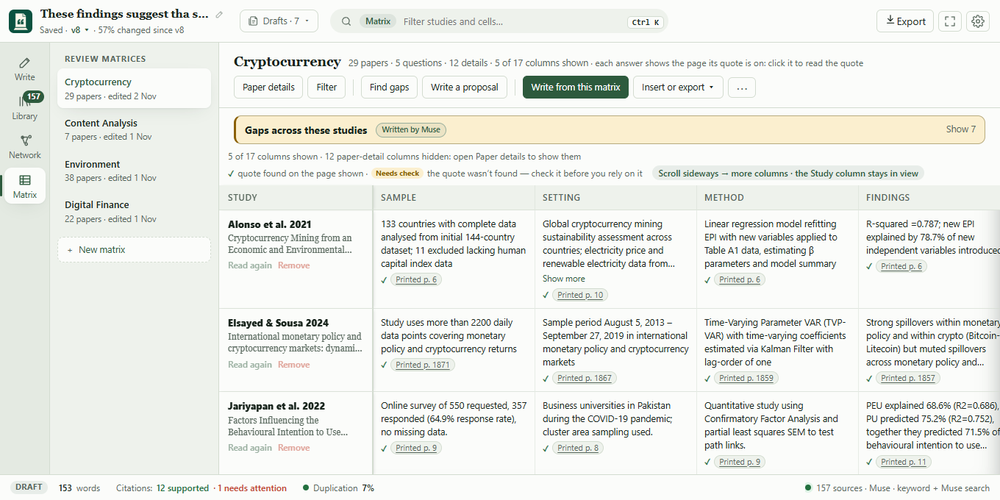
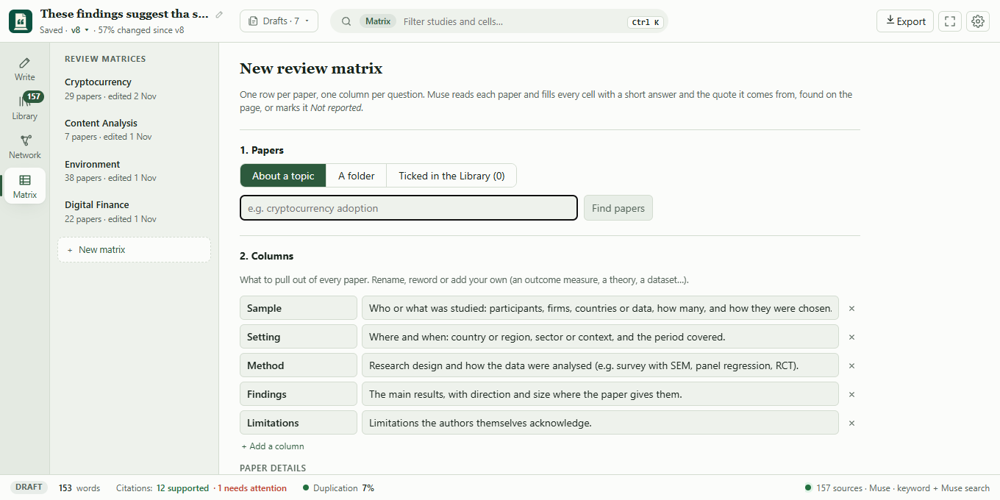
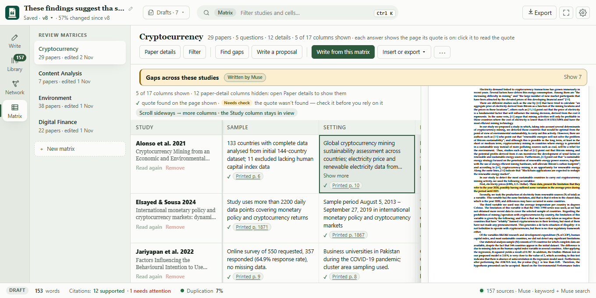

# Research Companion: user guide

Research Companion keeps the papers, notes, slides, scans and web pages you're writing from in one local library, and helps you write from them with citations that are checked against the source.

This guide is about using the app. For setup, see the [README](../README.md#run-it). For how the code fits together, see [ARCHITECTURE.md](ARCHITECTURE.md).

- [The layout](#the-layout)
- [Try the demo](#try-the-demo)
- [1. Add your sources](#1-add-your-sources)
- [2. Organize the library](#2-organize-the-library)
- [3. Write a draft](#3-write-a-draft)
- [4. Back up each claim](#4-back-up-each-claim)
- [5. Check the draft](#5-check-the-draft)
- [6. Export](#6-export)
- [The citation network](#the-citation-network)
- [Review matrix](#review-matrix)
- [Keyboard shortcuts](#keyboard-shortcuts)
- [Settings](#settings)
- [Troubleshooting](#troubleshooting)

## The layout

The window has four parts:

| Part | What it holds |
|---|---|
| **Top bar** | The draft's title (click it for your drafts), whether it's saved and its version; one search box; Export; Focus mode; Settings. |
| **Rail** (left) | The places in the app: **Write**, **Library**, **Network** and **Matrix**. One fills the window at a time. |
| **Main area** | The place you picked. In Write, the draft with the writing tools beside it. |
| **Status bar** (bottom) | Live counts for the draft: words, citations verified, duplication, and how much it changed since the last version. Click any of them to open the matching tool. |

**One search box.** In Write, the box searches everything (sources, drafts, folders) and runs any action; Ctrl K opens it from anywhere. In the Library it filters your sources, and in the Network it finds papers about a topic. The green chip in the box says which one it's doing. Esc clears it, and Ctrl K still searches everything.

### Open and close the writing tools

The **>|** button at the top-right of the panel, beside its *Writing tools* title, or `Ctrl+\`, closes the writing tools and gives the page the room. A slim strip of their icons stays on the right, with their counts (citations to confirm, duplication, change since the last version):

Click an icon to open that tab, or the **|<** button at the top of the strip (the same corner) to open the panel as it was. Anything that needs a tool opens it by itself: clicking a citation or a cite marker, a count in the status bar, or an action from Ctrl K. The app remembers whether you left it open; Settings can make it always start open or closed.

### Focus mode

The **⛶** button in the top bar, or Ctrl+Shift+F, hides everything but the page and its toolbar:

The save state stays in the corner. Esc, or **Exit focus**, brings the rest back.

## Try the demo

A new library opens on **Getting started**. If its first step says *Connect the AI*, the app is running on the offline mock, which matches words instead of reading them; **Add a Muse key** opens Settings at **AI model**. The status bar says so too: *Offline mock* shows in amber, and clicking it opens the same place.

**Try the sample library** (under *Add your sources*, or **Load sample library** in Ctrl K) adds six small files on sleep and coral reefs: two papers, reading notes, a fieldwork log, lab slides and a chapter outline. When they're in, the demo draft opens: four sentences from those papers, each with a cite marker that starts checking it at once. One sentence is false on purpose: the sleep paper found that reactivation during REM sleep did nothing, so Muse marks the claim that it helped as unsupported. (On the mock it may only be marked partial, or even pass.)

Above the draft, a checklist walks through the app, and each step ticks itself off when you do it. The button, tab or marker for the next step pulses:

1. **Confirm a source:** click a green marker, then **Use this source**.
2. **See the quote on its page:** click the citation that replaced it.
3. **Draft with the Assistant:** ask for a paragraph and insert it.
4. **Check for duplication:** open **Review**.
5. **Export to Word.**

**Reset demo** puts the draft back as it was written and clears the checklist, to run it again. **Remove samples** takes the sample files out of the library (they don't stay in *Removed* either) and deletes the demo draft; your own sources and drafts stay. **Hide** puts the checklist away; **Open demo draft** in Ctrl K brings it back. The sample files are copied into the data folder (`samples`) and read from there.

## 1. Add your sources

Open **Library** in the rail and click **+ Add sources**:

- **Files…** picks one or more files.
- **Folder…** adds every readable document in a folder and its subfolders.
- **Paste a link or path…** takes a web page address, or a file or folder path on this computer.

You can also drop files anywhere on the window. A single Word file opens the [import dialog](#bring-in-a-word-file); anything else goes to the library.

The library reads PDF, Word (.docx), PowerPoint (.pptx), Markdown, plain text, HTML and images (PNG, JPEG, WebP). Scanned pages and images are read with OCR.

While files are being added, a card at the top of the library shows each file's stage, and each source appears in the list as soon as it's read (Muse takes about 15 seconds per file). Messages like "Added 6 sources" close by themselves after a few seconds; error messages stay until you click them.

Files are added in the background. A card under the Library's header shows each file's progress (reading, Muse reading it, filing into folders), and **Stop** cancels the rest. When Muse can't write a summary or tags (it's offline or rate-limited), the paper is still searchable and citable; it's marked *no summary yet* and the library offers **Try again**.

Your files stay where they are. The library keeps its own index in `~/.research-companion/`; only text passages, and images that need OCR, are sent to Muse.

## 2. Organize the library

- **Find a paper:** type in the search box at the top. It matches titles, authors, journals, keywords, tags, JEL codes and summaries. The **All types** menu narrows to PDFs, slides, notes and so on.
- **Sort:** click a column header (Title, Authors, Year, Type, Added). Click again to reverse.
- **See a paper's details:** click its row. Its details open on the right: summary, folders, keywords and JEL codes, DOI, link and file location. With the table selected, ↑ and ↓ move between papers and Esc closes the details.
- **Open a paper:** double-click its row (or press Enter with it selected). A PDF opens in the app's reader described below, a Word file, slides or an image in the app your computer opens it with, and a web page in your browser.
- **Correct its details:** **Edit details** fixes the title, authors, year, journal, DOI or link. Reference lists are built from these, and your corrections are kept if the file is added again.
- **Read the whole PDF:** **Open PDF** in its details opens it in the app's reader, where you can highlight passages and add notes (see [Highlights and notes](#highlights-and-notes)). **Open in PDF viewer** at the top of the reader opens it in a window of its own instead, with search, zoom, thumbnails and print, which you can keep beside your draft; it reuses one window and remembers its size and place. **Show in folder** finds the file on disk.
- **Remove it:** **Remove from library** at the bottom of its details. The file on disk isn't touched.

### Subject folders

Folders are subjects, not places on disk. Click **New folder**, type a subject (say, *Digital finance*) and pick how closely a paper must match it (50% by default). Every paper that matches is filed in, and one paper can sit in several folders.

- Open a folder to change its threshold with the slider, rename it or delete it. Papers stay in the library when a folder is deleted.
- Take a paper out of a folder with the × on its folder chip, or add it to one by typing a folder name under **Folders** in its details. Dragging a row onto a folder files it there too. Your own changes survive re-filing.
- **⋯ → Re-file papers into folders** scores every paper against your folders again.

### Pick the sources to draft from

Tick the box in front of a paper to have the Assistant and the cite searches use only the ticked papers. The bar above the table says how many are ticked, with **Clear** to untick them. With nothing ticked, the whole library is used.

### Timeline

**◷ Timeline** above the table opens a date slider with a bar for each month showing how many sources fall in it. A library that spans more than 15 years is shown year by year.

- **Added** goes by when you got each file: its date on this computer, or the day you added it here if that is earlier. Drag the two handles to a range, or click a bar to jump to that month.
- **As of** uses one handle and shows your library as it was at the end of that month. Sources removed since then are listed greyed out at the bottom. Open one to restore it.
- **Published** goes by publication date. Papers known only by year show as lighter bars spread across that year. **Look up exact dates** looks the papers up in OpenAlex and Crossref (see below), which gives the full date and fills in the DOI of papers that have none.

### Removed sources

Removing a source, yourself or from Find duplicate files, keeps a record of it under **Removed**: when it was added, when and why it was removed (and which copy was kept, for a duplicate), and whether its file went to the Recycle Bin. **Restore** reads the file again and brings it back under its old id, so drafts that cite it work again, with its old added date, your corrections and your folders. If the file has moved or gone to the Recycle Bin, put it back first. If you add a file you removed before, its details say so. **Forget this record** clears the entry.

### More library tools (⋯)

- **Find duplicate files:** copies of the same paper, with what you could free up. It suggests what to keep and can move a copy to the Recycle Bin; it never deletes outright.
- **Most-cited papers you don't have:** what your papers on a topic cite most that isn't in your library, with free copies to download where one exists.
- A paper's **Cited papers…** button lists the works it cites and downloads free copies of them. Entries marked "from OpenAlex" weren't found in the paper's own reference list.
- A paper's **Citing papers…** button lists newer works that cite it (from OpenAlex), the most cited or the newest first, with their abstracts and free copies to add.
- **Look up papers in scholarly indexes:** fetches the publisher's details (journal, volume, issue, pages), the authors' abstract, the reference list and the citation count for every paper not looked up yet; once all are, it refreshes them. New imports are looked up automatically unless you turn that off in Settings → Library. What you corrected yourself is never changed. If the DOI on a paper belongs to another work, nothing is taken and its details tell you.

## 3. Write a draft

Click **Write** in the rail. The draft is saved as you type; the top bar says *Saving…* and then *Saved*.

### Drafts

Click the draft's title in the top bar for your drafts:

From there you can start a **New draft** (Ctrl+N), **Import a Word file** (Ctrl+O), switch to another draft, rename one with its pencil, or delete one with its ×.

**Name a draft:** double-click its title in the top bar (or use the pencil in the drafts menu), type a name and press Enter; Esc cancels. Until you name it, a draft is called after its first line. A name you give stays when the text changes, and it's the file name when you export. Clear the name to go back to the first line. A draft opened from a Word file or written as a proposal starts with that file's or proposal's name.

### Bring in a Word file

Ctrl+O, the drafts menu, or dropping a .docx on the window opens a preview of what was read. Choose where it goes:

- **A new draft**,
- **into the open draft** (at the cursor, or at the end if you haven't clicked into it; Ctrl+Z takes it out again), or
- **the library**, as a source you can cite.

Headings, lists, quotes, bold, italic, underline, strikethrough, links and line breaks come across. Tables become one line per row and images are left out; the preview says when that happened.

### The Assistant

The **Assistant** tab drafts from your sources. Type what you want (or pick an example) and click **Draft with citations**. Every sentence comes with a quote from a source, and each quote is checked in the background:

| Mark | Meaning |
|---|---|
| verified (green) | The quote is in the source and supports the sentence. |
| weak (amber) | The quote is there but only partly supports it. |
| unsupported / quote not found (red) | The source doesn't back the sentence, or the quote isn't in it. |
| from your matrix (blue, square mark) | Written from a review matrix and checked against the whole matrix (see [Review matrix](#review-matrix)). |

While it drafts, the tab counts the seconds (it usually takes 10 to 30) and says why when it's slower: Muse is busy and retrying after a rate limit. **Cancel** stops waiting; nothing is added to your draft (Muse may still finish in the background, and that answer is dropped).

Click a citation to see its passage. Tick the sentences you want to keep (or click a sentence; **Select all** ticks every one), then **Insert N selected** puts just those in, in the draft's order, at the cursor, or at the end if you haven't clicked into the page yet.

### Highlights and notes

**While reading.** Open a PDF (double-click it in the Library, or **Open PDF**). Select text on a page and a small bar appears:

- **Highlight** marks it in yellow. It stays on the page every time you open the paper.
- **Add note** highlights it and opens a note for an idea you have while reading. A ✎ mark in the margin shows a highlight has a note.

Click a highlight to read or change its note, or **Remove highlight**. A highlight has to be on one page. Scanned pages without a text layer can't be selected.

**While writing.** The **Highlights** tab beside the draft lists everything you highlighted, with your notes. It's ranked for the paragraph your cursor is in each time you open it; click into another paragraph and **Fetch** to rank it again. The ranking runs on your computer, with nothing sent anywhere.

- **Insert quote** puts the highlight into the draft as a quote with its citation, already verified, because it's the paper's own words.
- Tick a few and **Write from N**: Muse writes sentences from them, following on from your draft and guided by your notes. They're cited and checked like the Assistant's, and you tick the ones to insert.
- Click a paper's label to open it at that page.

Your notes are your own ideas: Muse may use them as guidance, but they're never cited as a source. A highlight whose text the app can't find in the paper's stored text (rare, mostly odd layouts) is listed but can't be cited.

### Ask

The **Ask** tab is a plain AI chatbot: ask it to explain a concept, reword a sentence, suggest a title, or anything else. Type a message and press Enter (Shift+Enter starts a new line). It remembers the conversation, so follow-ups work, and it also sees the paragraph your cursor is in.

Ask answers from the AI's own knowledge, not your library, and its replies have no citations: check facts before you rely on them. To write from your sources with cited quotes, use the Assistant.

To ask about part of your draft, select it and press **Ctrl J**, or click **Ask** in the toolbar beside Cite. The Ask tab opens with the text attached above the message box (× removes it).

Replies show formatted (bold, lists, headings, tables, code). **Insert into draft** under a reply puts it at the cursor with that formatting.

Each draft keeps its own chat, also after you close the app; **Clear conversation** at the top of the tab starts it over.

While Muse answers, the tab counts the seconds and says why when it's slower (Muse busy and retrying, or switched to Meta's API). **Cancel** stops waiting and puts your question back in the box; if Muse still answers, the reply appears the next time the chat loads.

## 4. Back up each claim

Put the cursor in a sentence you wrote (or select some text) and press **Cite** in the toolbar, or Ctrl+Shift+C. A small grey `cite` marker appears at the end of the sentence and you keep writing; the search runs in the background and the cursor doesn't move.

The marker turns green when a source supports the sentence, amber for partial support, and red when nothing does. It never changes size, so the line you're typing doesn't shift.

Click a marker to open the **Citations** tab with what was found. **Use this source** turns the marker into a citation (Ctrl+Z undoes it). You can also search again for a reworded sentence, or **Remove marker**. With no marker open, the tab lists every marker still waiting.

While markers are still searching, the top of the tab says how many sentences are being checked and for how long. Three are checked at a time, so each waiting row says **Checking…** or **Waiting its turn**.

### Recheck every citation

After rewording sentences, or adding and removing sources, press **Recheck all citations** in the **Citations** tab, or pick it from Ctrl K. Each citation's quote is found in your library as it is now and checked again against its sentence as it reads now. Blue citations, written from a review matrix, are checked against the matrix instead. Every `cite` marker searches again. Citations turn grey while they're checked and you can keep writing. When it's done, a note says how many were verified and how many were flagged. If the backend didn't answer for a citation, it keeps its earlier result.

### See the quote on its page

Click any citation in the draft. The **Citations** tab shows its passage highlighted on the page, and a dashed line joins the citation to the quote:

For a PDF you see the page as it's printed, with the quote highlighted on it. **Text** switches to the text read from the page (handy for small print, and what other kinds of source always show); **Page** switches back, and the app remembers your pick. If a quote can't be placed on the page image (a scan, say), the text is shown instead, with a note.

The page line gives both numbers when they differ: the printed page (p. 342) and the PDF page (2 of 2). The arrows turn pages. **Open the whole PDF at this page** opens it in its PDF window at that page:

Close that window as you would any other. **‹ Back** returns to the tab you came from.

### Reference list

The **References** tab builds the reference list for every source the draft cites, in the style chosen in Settings: APA 7, MLA 9 or IEEE. **Copy** copies the list, and **Copy as BibTeX** copies the same sources as BibTeX entries for a reference manager or LaTeX.

## 5. Check the draft

### Duplication

The **Review** tab checks the draft for sentences that repeat each other, and for text that matches a source closely, cited or not:

It checks when you open it, and again a few seconds after you edit while it stays open. Matching passages are underlined in the draft: red for an uncited match, dotted for a cited one, wavy for a repeat. Click a finding to jump to it, or its source to see the matching passage. The status bar shows the overall percentage.

### Versions

The **History** tab keeps versions of the draft. Snapshots are taken automatically as you write; **Save a version** makes a named milestone (say, *Sent to advisor*). Pick a version to see what changed, by document, section or paragraph, each with a percentage. **Restore** brings an old version back and keeps a snapshot of the draft as it was first, so nothing is lost.

## 6. Export

**Export** in the top bar saves the draft as a Word file. Citations are written in your citation style with a reference list at the end. A citation that didn't pass the check gets a Word comment saying why, and a `cite` marker you haven't confirmed is left out of the text with a comment on its sentence.

## The citation network

**Network** in the rail shows your papers as a graph. It starts by asking what to show, since laying out a whole library at once can keep the window busy for a long time:

- **Map this topic:** type a topic there or in the search box at the top. You get the papers about it and the works they cite that you don't have.
- **Map the ticked papers:** the papers ticked in the Library.
- **Map the whole library:** every paper. Above 60 papers it warns that this can take a while.

**Change** next to the counts goes back to choosing.

- An arrow from A to B means A cites B. Grey lines join papers that share references, and dashed amber lines (Shared keywords) join papers with keywords in common. The checkboxes at the top turn each kind on or off.
- Dashed circles are works that several of your papers cite but that aren't in your library.
- Click a paper to highlight its neighbours and list what it cites, what cites it, and what it shares. **Open in library** jumps to it.
- **Rank and download…** lists the works the papers shown cite but you don't have, with free copies to fetch. Clearing the search box goes back to choosing what to show.

Esc returns to the draft.

## Review matrix

**Matrix** in the rail builds a literature review matrix: one row per paper, one column per question (sample, setting, method, findings, limitations, or your own), the table systematic reviewers fill in by hand.

**Make one.** Click **+ New matrix**:

1. **Papers:** those *about a topic* you type, those in *a folder*, or those *ticked in the Library*. Untick any you don't want (at most 80; copies of the same paper are offered once).
2. **Columns:** the standard five questions, which you can rename, reword or remove, and add your own: an outcome measure, a theory, a dataset. Each has a sentence saying what to extract. Under **Paper details**, switch on details from each paper's record (Year, Journal and Cited are on to start with; also Authors, Published, Volume (issue), Pages, Publisher, DOI, Abstract, Keywords and JEL codes).
3. **Build the matrix.** Muse reads several papers at once (about a minute for 30) while you keep working; cells fill in as they're read, and the progress bar says about how long is left. If you're in another place in the app or another window when it finishes, a desktop notification says so. **Find gaps** and **Write** show how long they've been working, and why when Muse is slow.

**Every cell rests on a quote.** For each paper, the app finds the passages that best answer each column (and the opening, where abstracts say most); Muse writes a short answer from them and copies the sentence it used. The app then finds that quote in the paper:

| Cell | Meaning |
|---|---|
| answer with a green dot and a page | the quote was found on that page |
| answer with an amber dot | the quote wasn't found in the paper: check it |
| *Not reported* | the passages read don't say; nothing is guessed |

Answers say only what their quote shows, so they can be checked; a fuller answer spread over several passages is cut to the part the quote covers.

**Check and correct.** Click a cell to open it beside the table, with its quote highlighted on the PDF page:

Edit the answer and **Save answer** (it keeps its quote as evidence), **Read again** to have Muse redo that cell, or **Open PDF** at the page. Hover a paper's name for **Read again** (the whole row) or **Remove**. Click a question's heading to rename it, change what it asks (it's read again for every paper, except answers you wrote) or remove it; **⋯ → Add a question** adds one. The search box at the top filters the rows.

**Use it.**

- **Find gaps:** Muse reads the finished matrix and names what the studies leave out (populations, places, periods, methods) and where their findings conflict, naming the studies each gap rests on. They're listed in one box, **Gaps across these studies**, above the table. **Insert into draft** beside a gap puts it in the draft, citing every paper in the matrix. Running Find gaps again updates that box: the wait shows inside it, new gaps are marked **New**, and gaps the new run didn't find are removed, except those a draft (or a saved version of one) cites. Those stay, greyed and marked **In your draft**, so their citations can still be checked against the matrix.
- **Write from this matrix:** Muse writes a comparison of the studies from the matrix's quotes, each sentence citing them. Tick the sentences to keep and insert them into the draft.
- **Kept with the matrix:** every gap and every written passage keeps a copy of the rows it came from. Passages you insert are listed in the same box under **Written from this matrix**. The box shows when the matrix has changed since one was written, and you can insert one again or delete it.
- **Write a proposal:** plans a study that addresses the gaps (see [Write a research proposal](#write-a-research-proposal)).
- **Insert into draft:** the matrix as a table at the cursor, with the columns you choose. Each cell cites its quote, so the paper joins the reference list and the Word export; the citations are checked in the background, like the Assistant's. In the draft, **−Row**, **−Col** and **×Table** appear in the toolbar while the cursor is in a table.
- **Export:** an *Excel workbook* or *CSV* (each column's answer, then its evidence: page and quote), or a *Word table* whose cells cite their sources in your citation style, with a reference list.

**Paper details.** Detail columns show each paper's record as it is in your library: what OpenAlex and Crossref found (see [More library tools](#more-library-tools-)) and what you corrected under Edit details. They aren't read by Muse, so they fill in at once, cost nothing, carry no quote, and change when the record does. **Paper details** above the table adds or removes them (questions are limited to 12, details aren't).

- **Sort:** click a detail's heading: years and citations go newest or most first, then the other way, then back to the order they were added. Papers without that detail go last.
- **Filter:** **Filter** narrows the rows by a detail: years or citations between two numbers, or a journal, author or keyword containing a word. Filters add up, each shows as a chip (× removes it), and papers without the detail are left out while it applies.
- They're used too: **Find gaps** and **Write from this matrix** are told each study's details (e.g. that no study is after 2018, or that the most cited one disagrees), though only quotes are cited. The Excel, CSV and Word exports and **Insert into draft** include them as plain columns.

Matrices are saved with your library; **⋯ → Delete this matrix** removes one (the papers stay).

**Citations from the matrix are blue.** A gap or a written passage often compares several studies or says what none of them covers. One quote can't back a sentence like that, so its citations aren't checked against their quotes. Muse checks the sentence against the whole matrix: each study's answers and the quotes behind them. Blue means the matrix supports it; amber or red means it doesn't, with the reason. Click a blue citation to see:

- the gap or passage it came from, and the matrix rows it rests on;
- a note if the matrix has changed since, or was deleted (checks then use the copy kept with it);
- **Check against the matrix**, which uses the sentence as it reads now, and **Open matrix**;
- for a written passage, **View quote** and **Check against the quote…**, which warns first that one passage will probably show weak or no support for a sentence written from the whole matrix.

**Recheck all citations** checks blue citations against the matrix too. In the Word export, a gap's citations name each paper without a page, the papers join the reference list, and blue citations get no comment.

### Write a research proposal

**Write a proposal** above a matrix (or *Write a research proposal* in Ctrl K) plans one study that addresses the gaps you found, in four steps:

1. **Gaps:** tick the gaps to address, from one matrix or several. Ticking more than one matrix draws on several reviews, and a paper in two of them counts once. You can also say what the study should focus on, or write a focus instead of ticking gaps.
2. **Variables:** Muse suggests the variables such a study would use, most central first, each with a likely role and how the reviewed studies measured it. Only three start switched on: the outcome, its main cause and the next most central one, which makes the simplest study. Give any other a role (independent, dependent, mediator, moderator or control) to use it too, add your own, and say how you'd measure each if you know. Muse uses the fewest of the ones you switch on that answer the study's question.
3. **Limits:** what you don't want (one per line, e.g. *No randomised trials*), which Muse treats as strict rules, and what you have to work with (data, time, budget, skills). Both start with your last answers.
4. **Proposal:** Muse first plans one study, as simple as the gaps allow: a short, plain title naming the outcome and its main cause, a core question, usually one or two research questions (at most three), and which gaps fit. A mediator or moderator comes in only when a chosen gap is about one. Gaps that would make it a second study are left out, and you're told which and why. A separate Muse call then reviews the study's focus: it strips from the title and core question anything there only to bring in another topic, and keeps, revises or removes each research question against the core question (another outcome, population or kind of data is another study; a question that strings together controls is cut down to one relationship). You see what it changed. Only then is the rest written, around the questions that remain, and checked against what you ruled out. While it works (usually 1 to 3 minutes), the dialog shows which of the five steps is running: planning, reviewing the questions, writing, checking against your limits and the matrices, and rewriting what the matrices don't back. If you switch to another window, a desktop notification says when it's ready. If it breaks a rule you see where, with **Write it again without these**. **Has this been done?** searches OpenAlex for published studies close to the first research question, marking any already in your library. **Open as a new draft** opens it in the editor.

The draft has a title and Background, The gap, Research questions, Hypotheses, Variables (a table: the role, how the reviewed studies measured each variable and how this study will), Design, Data, Analysis, Contribution, Limitations and Timeline. Only what describes the reviewed studies cites them (background, the gap and the earlier measures), with blue citations, each checked against the matrix rows of the studies it cites. A paragraph those rows don't back gets one repair: Muse rewrites it from the rows and the check's reason, and the rewrite replaces it only if it's better backed (one the rows contradict, and nothing can be saved of, is taken out). The dialog lists what was rewritten and what still isn't fully backed, with Muse's reasons. A measure the matrices don't state is taken out of the Variables table rather than left in red, and listed too. Everything from the research questions on is proposed for your study, so it cites no one. A note under the title says so, to delete when you no longer need it.

## Keyboard shortcuts

| Keys | What it does |
|---|---|
| Ctrl K | Search everything and run any action |
| Ctrl N | New draft |
| Ctrl O | Import a Word file |
| Ctrl Shift C | Cite the sentence at the cursor |
| Ctrl J | Ask about the selected text (or open the Ask tab) |
| Ctrl \ | Open or close the writing tools |
| Ctrl Shift F | Focus mode on or off |
| Ctrl Z / Ctrl Y | Undo / redo in the draft |
| Esc | Leave focus mode; close the PDF viewer or a menu; clear the search box; leave the Library or Network for the draft |
| ↑ ↓ | Move between papers in the library table (when it has focus) |

On a Mac, use Cmd in place of Ctrl.

## Settings

The gear in the top bar opens Settings. Changes apply as you make them and are kept in your library, so they follow it.

**Appearance & editor**

- **Theme:** Light, Dark, or System (follows your computer).
- **Page width**, **Text size** and **Draft font** (Charter, Georgia or sans serif): how the draft looks on screen. Fonts and sizes you set on text in the toolbar keep theirs, and Word export uses the toolbar's.
- **Spelling:** underline misspelled words, or not.
- **Writing tools at start:** as you left them, always open, or always closed.

**Writing & citations**

- **Citation style:** APA 7, MLA 9 or IEEE, for the References tab and Export.
- **Passages the Assistant reads** (3 to 20, default 8): fewer is faster and sticks to the closest matches; more covers more ground.
- **Cite markers search:** the sources ticked in the Library (all of them when none are ticked), or always the whole library.

**Review & history**

- **Duplication sensitivity** (30–90%, default 50%): a sentence is flagged when at least this share of its wording is found in a source. Lower catches more paraphrase; higher flags only near-copies. It applies from the next check.
- **Re-check automatically** while the Review tab is open.
- **Automatic snapshots:** at most every N minutes (default 10), and **Snapshots to keep** (default 40). Versions you name are always kept.

**Library**

- **New folders start at** a similarity of N% (default 50%).
- **Contact email** (optional): sent to OpenAlex, Semantic Scholar and Crossref when finding free copies of cited papers.
- **Look papers up in scholarly indexes** (on by default): after an import, each paper's DOI or title is sent to OpenAlex and Crossref for its journal details, abstract, reference list and citation count.
- **CORE API key** (optional): with a key (free from core.ac.uk/services/api), free copies are also searched for in CORE, which gathers full texts from university repositories. The key is checked with CORE before it's saved.

**Search**

- **Now:** the models that find matching passages (embeddings, bge-small) and put the best first (the reranker). Both run on this computer.

**AI model**

- **Model:** Muse (through Meta's Model API), or the offline mock (no key; rough results). **Save and switch** changes it at once, with no restart.
- **Meta Model API key:** paste a key to save or replace it. It's written to the `.env` file in your data folder and never shown again; only its last four characters are, so you can tell which one it is.
- **Reasoning effort:** how much Muse thinks before answering, from *minimal* (fastest) to *xhigh* (most thorough). *low* is the default.

If one of these is also set as a system environment variable, Settings says so: that value wins the next time the app starts.

## Troubleshooting

| What you see | What to do |
|---|---|
| *loading search model…* in the status bar | The search model loads in the background when the app starts: about a second (the installer includes it, so nothing downloads), or longer once after an update that changed the model, while your library is re-embedded. Your library and drafts work meanwhile; searching, cite markers and imports wait until it's ready. |
| *search model failed to load* | The backend log (`~/.research-companion/logs/backend.log`) says why. The installed app has the model with it; a development setup without `npm run fetch-models` downloads it on first launch and needs internet then. |
| *Backend offline, reconnecting…* | The backend stopped; the app restarts it by itself (up to 3 times a minute). Hover the message for the log file's location. |
| *Restart the app to finish updating* | The backend is older than the window. Close and reopen the app. |
| *no summary yet* on papers | Muse was unavailable when they were added. Click **Try again** in the Library. |
| A citation turns red with "no longer in your library" | Its file was removed, or re-added with different text. Cite the sentence again. |
| Summaries look rough | You're on the offline mock model. Switch to Muse in **Settings → AI model**. |
| A cited PDF page shows *Loading the page…* or falls back to text | The file was moved or deleted since it was added (Open PDF says where it was expected), or it's a scan with no text layer. |
