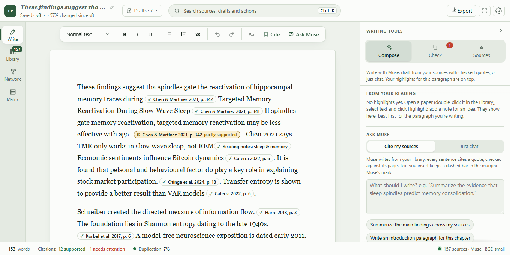
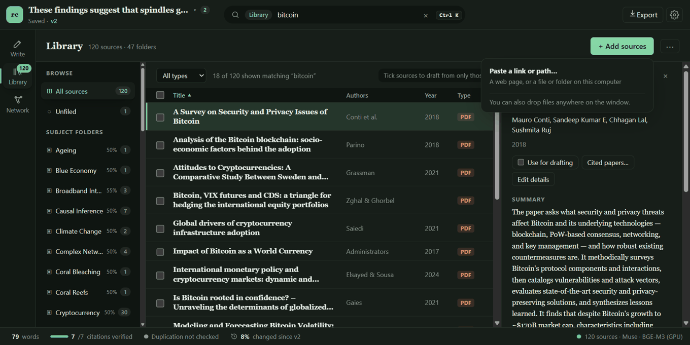
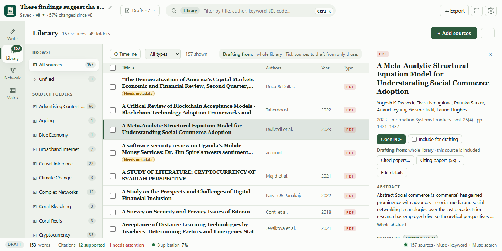
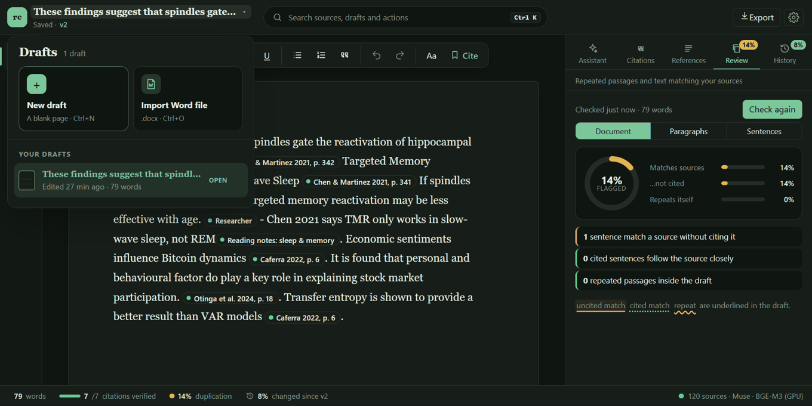
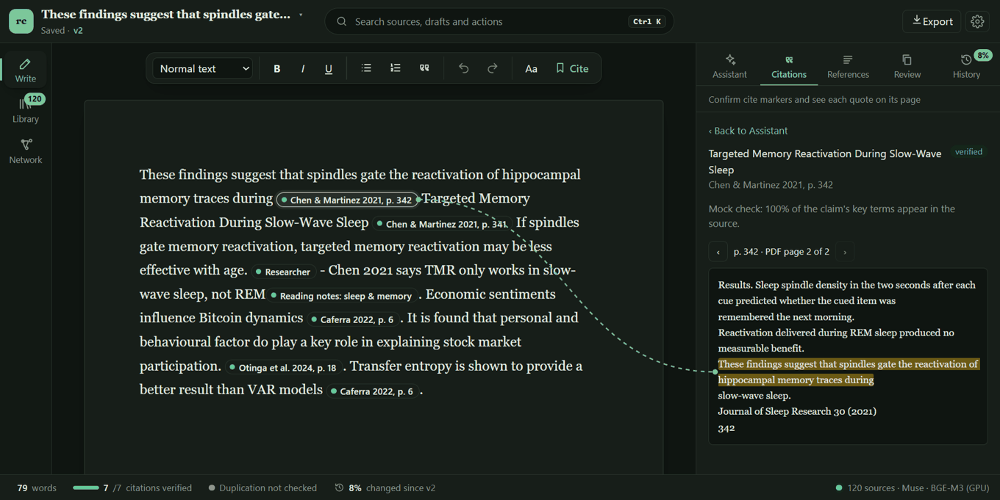
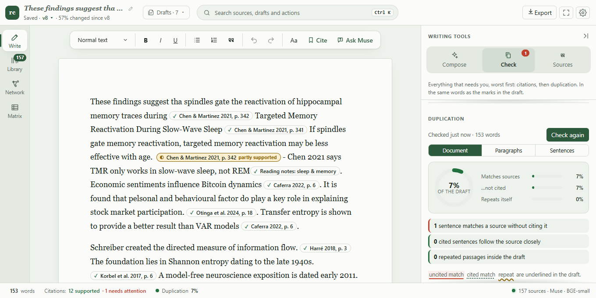
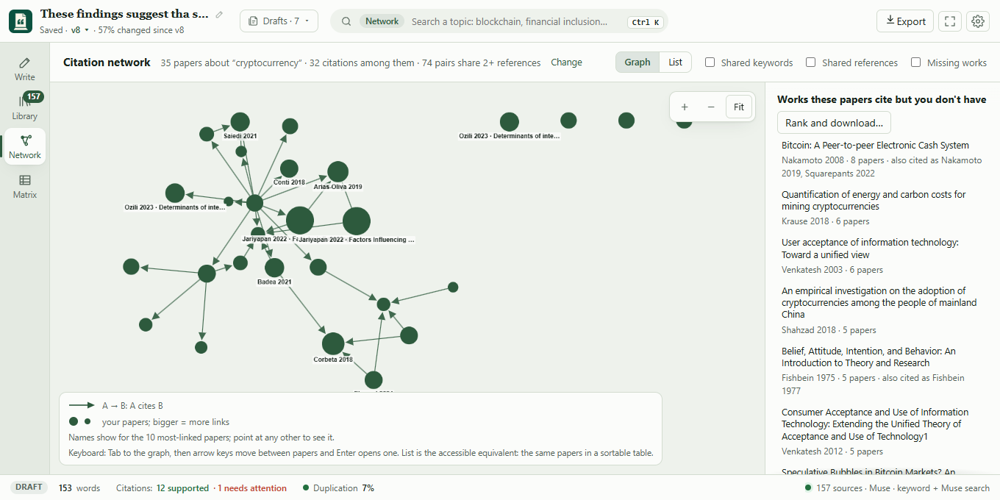

# Research Companion: user guide

Research Companion keeps the papers, notes, slides, scans and web pages you're writing from in one local library, and helps you write from them with citations that are checked against the source.

This guide is about using the app. For setup, see the [README](../README.md#run-it). For how the code fits together, see [ARCHITECTURE.md](ARCHITECTURE.md).

- [The layout](#the-layout)
- [1. Add your sources](#1-add-your-sources)
- [2. Organize the library](#2-organize-the-library)
- [3. Write a draft](#3-write-a-draft)
- [4. Back up each claim](#4-back-up-each-claim)
- [5. Check the draft](#5-check-the-draft)
- [6. Export](#6-export)
- [The citation network](#the-citation-network)
- [Keyboard shortcuts](#keyboard-shortcuts)
- [Settings](#settings)
- [Troubleshooting](#troubleshooting)

## The layout

The window has four parts:

| Part | What it holds |
|---|---|
| **Top bar** | The draft's title (click it for your drafts), whether it's saved and its version; one search box; Export; Settings. |
| **Rail** (left) | The three places in the app: **Write**, **Library** and **Network**. One fills the window at a time. |
| **Main area** | The place you picked. In Write, the draft with the writing tools beside it. |
| **Status bar** (bottom) | Live counts for the draft: words, citations verified, duplication, and how much it changed since the last version. Click any of them to open the matching tool. |

**One search box.** In Write, the box searches everything (sources, drafts, folders) and runs any action; Ctrl K opens it from anywhere. In the Library it filters your sources, and in the Network it finds papers about a topic. The green chip in the box says which one it's doing. Esc clears it, and Ctrl K still searches everything.

## 1. Add your sources

Open **Library** in the rail and click **+ Add sources**:

- **Files…** picks one or more files.
- **Folder…** adds every readable document in a folder and its subfolders.
- **Paste a link or path…** takes a web page address, or a file or folder path on this computer.

You can also drop files anywhere on the window. A single Word file opens the [import dialog](#bring-in-a-word-file); anything else goes to the library.

The library reads PDF, Word (.docx), PowerPoint (.pptx), Markdown, plain text, HTML and images (PNG, JPEG, WebP). Scanned pages and images are read with OCR.

Files are added in the background. A card under the Library's header shows each file's progress (reading, Muse reading it, filing into folders), and **Stop** cancels the rest. When Muse can't write a summary or tags (it's offline or rate-limited), the paper is still searchable and citable; it's marked *no summary yet* and the library offers **Try again**.

Your files stay where they are. The library keeps its own index in `~/.research-companion/`; only text passages, and images that need OCR, are sent to Muse.

## 2. Organize the library

- **Find a paper:** type in the search box at the top. It matches titles, authors, journals, keywords, tags, JEL codes and summaries. The **All types** menu narrows to PDFs, slides, notes and so on.
- **Sort:** click a column header (Title, Authors, Year, Type, Added). Click again to reverse.
- **Open a paper:** click its row. Its details open on the right: summary, folders, keywords and JEL codes, DOI, link and file location. With the table selected, ↑ and ↓ move between papers and Esc closes the details.
- **Correct its details:** **Edit details** fixes the title, authors, year, journal, DOI or link. Reference lists are built from these, and your corrections are kept if the file is added again.
- **Remove it:** **Remove from library** at the bottom of its details. The file on disk isn't touched.

### Subject folders

Folders are subjects, not places on disk. Click **New folder**, type a subject (say, *Digital finance*) and pick how closely a paper must match it (50% by default). Every paper that matches is filed in, and one paper can sit in several folders.

- Open a folder to change its threshold with the slider, rename it or delete it. Papers stay in the library when a folder is deleted.
- Take a paper out of a folder with the × on its folder chip, or add it to one by typing a folder name under **Folders** in its details. Dragging a row onto a folder files it there too. Your own changes survive re-filing.
- **⋯ → Re-file papers into folders** scores every paper against your folders again.

### Pick the sources to draft from

Tick the box in front of a paper to have the Assistant and the cite searches use only the ticked papers. The bar above the table says how many are ticked, with **Clear** to untick them. With nothing ticked, the whole library is used.

### More library tools (⋯)

- **Find duplicate files:** copies of the same paper, with what you could free up. It suggests what to keep and can move a copy to the Recycle Bin; it never deletes outright.
- **Most-cited papers you don't have:** what your papers on a topic cite most that isn't in your library, with free copies to download where one exists.
- A paper's **Cited papers…** button lists the works it cites and downloads free copies of them.

## 3. Write a draft

Click **Write** in the rail. The draft is saved as you type; the top bar says *Saving…* and then *Saved*.

### Drafts

Click the draft's title in the top bar for your drafts:

From there you can start a **New draft** (Ctrl+N), **Import a Word file** (Ctrl+O), switch to another draft, or delete one with its ×. A draft's title is its first line.

### Bring in a Word file

Ctrl+O, the drafts menu, or dropping a .docx on the window opens a preview of what was read. Choose where it goes:

- **A new draft**,
- **into the open draft** (at the cursor, or at the end if you haven't clicked into it; Ctrl+Z takes it out again), or
- **the library**, as a source you can cite.

Headings, lists, quotes, bold, italic, underline, strikethrough, links and line breaks come across. Tables become one line per row and images are left out; the preview says when that happened.

### The Assistant

The **Assistant** tab drafts from your sources. Type what you want (or pick an example) and click **Draft with citations**. Every sentence comes with a quote from a source, and each quote is checked in the background:

| Mark | Meaning |
|---|---|
| verified (green) | The quote is in the source and supports the sentence. |
| weak (amber) | The quote is there but only partly supports it. |
| unsupported / quote not found (red) | The source doesn't back the sentence, or the quote isn't in it. |

Click a citation to see its passage. **Insert into document** puts the draft at the cursor, or at the end if you haven't clicked into the page yet.

## 4. Back up each claim

Put the cursor in a sentence you wrote (or select some text) and press **Cite** in the toolbar, or Ctrl+Shift+C. A small grey `cite` marker appears at the end of the sentence and you keep writing; the search runs in the background and the cursor doesn't move.

The marker turns green when a source supports the sentence, amber for partial support, and red when nothing does. It never changes size, so the line you're typing doesn't shift.

Click a marker to open the **Citations** tab with what was found. **Use this source** turns the marker into a citation (Ctrl+Z undoes it). You can also search again for a reworded sentence, or **Remove marker**. With no marker open, the tab lists every marker still waiting.

### See the quote on its page

Click any citation in the draft. The **Citations** tab shows its passage highlighted on the page, and a dashed line joins the citation to the quote:

The page line gives both numbers when they differ: the printed page (p. 342) and the PDF page (2 of 2). The arrows turn pages. **‹ Back** returns to the tab you came from.

### Reference list

The **References** tab builds the reference list for every source the draft cites, in the style chosen in Settings: APA 7, MLA 9 or IEEE. **Copy** copies the list, and **Copy as BibTeX** copies the same sources as BibTeX entries for a reference manager or LaTeX.

## 5. Check the draft

### Duplication

The **Review** tab checks the draft for sentences that repeat each other, and for text that matches a source closely, cited or not:

It checks when you open it, and again a few seconds after you edit while it stays open. Matching passages are underlined in the draft: red for an uncited match, dotted for a cited one, wavy for a repeat. Click a finding to jump to it, or its source to see the matching passage. The status bar shows the overall percentage.

### Versions

The **History** tab keeps versions of the draft. Snapshots are taken automatically as you write; **Save a version** makes a named milestone (say, *Sent to advisor*). Pick a version to see what changed, by document, section or paragraph, each with a percentage. **Restore** brings an old version back and keeps a snapshot of the draft as it was first, so nothing is lost.

## 6. Export

**Export** in the top bar saves the draft as a Word file. Citations are written in your citation style with a reference list at the end. A citation that didn't pass the check gets a Word comment saying why, and a `cite` marker you haven't confirmed is left out of the text with a comment on its sentence.

## The citation network

**Network** in the rail shows your library as a graph:

- An arrow from A to B means A cites B. Grey lines join papers that share references, and dashed amber lines (Shared keywords) join papers with keywords in common. The checkboxes at the top turn each kind on or off.
- Dashed circles are works that several of your papers cite but that aren't in your library.
- Click a paper to highlight its neighbours and list what it cites, what cites it, and what it shares. **Open in library** jumps to it.
- Type a topic in the search box to show only the papers about it, and the works they cite that you don't have. **Rank and download…** lists those works with free copies to fetch.

Esc returns to the draft.

## Keyboard shortcuts

| Keys | What it does |
|---|---|
| Ctrl K | Search everything and run any action |
| Ctrl N | New draft |
| Ctrl O | Import a Word file |
| Ctrl Shift C | Cite the sentence at the cursor |
| Ctrl Z / Ctrl Y | Undo / redo in the draft |
| Esc | Clear the search box; close a menu; leave the Library or Network for the draft |
| ↑ ↓ | Move between papers in the library table (when it has focus) |

On a Mac, use Cmd in place of Ctrl.

## Settings

The gear in the top bar sets:

- **Theme:** Light, Dark, or System (follows your computer).
- **Citation style:** APA 7, MLA 9 or IEEE. It's used by the References tab and by Export.

## Troubleshooting

| What you see | What to do |
|---|---|
| *Starting backend…* for a long time on first launch | The local embedding model is downloading (about 30 MB, or about 2 GB for the GPU model). It only happens once. |
| *Backend offline, reconnecting…* | The backend stopped; the app restarts it by itself (up to 3 times a minute). Hover the message for the log file's location. |
| *Restart the app to finish updating* | The backend is older than the window. Close and reopen the app. |
| *no summary yet* on papers | Muse was unavailable when they were added. Click **Try again** in the Library. |
| A citation turns red with "no longer in your library" | Its file was removed, or re-added with different text. Cite the sentence again. |
| Summaries look rough | You're on the offline mock model. See [Using Muse](../README.md#using-muse) to switch to Muse. |
