# Groundwork: user guide

*Write only what your sources say.*

Groundwork keeps the papers, notes, slides, scans and web pages you're writing from in one local library, and helps you write from them with citations that are checked against the source.

This guide is about using the app. For setup, see the [README](../README.md#run-it). For how the code fits together, see [ARCHITECTURE.md](ARCHITECTURE.md).

- [The layout](#the-layout)
- [Home](#home)
- [Try the demo](#try-the-demo)
- [1. Add your sources](#1-add-your-sources)
- [2. Organize the library](#2-organize-the-library)
- [3. Write a draft](#3-write-a-draft)
- [4. Back up each claim](#4-back-up-each-claim)
- [5. Check the draft](#5-check-the-draft)
- [6. Export](#6-export)
- [The citation network](#the-citation-network)
- [Review matrix](#review-matrix)
- [Keyboard shortcuts](#keyboard-shortcuts)
- [Settings](#settings)
- [Troubleshooting](#troubleshooting)

## The layout

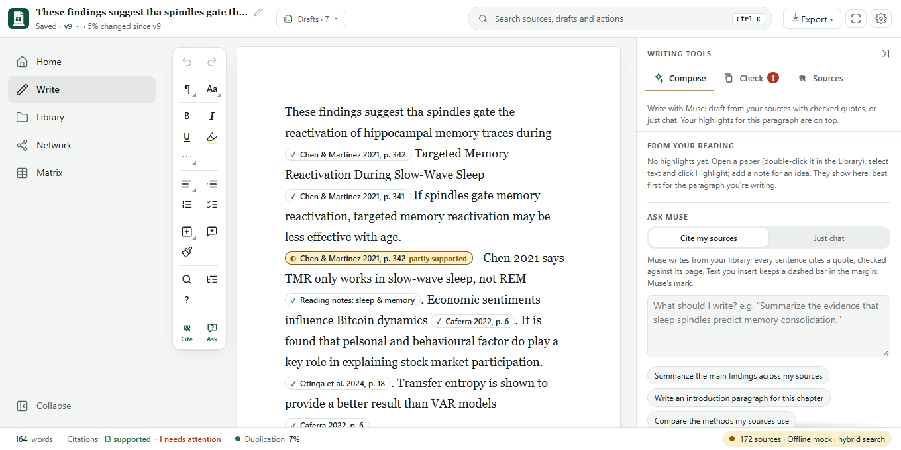

The window has four parts:

| Part | What it holds |
|---|---|
| **Top bar** | The draft's name (click it to rename), whether it's saved, its version (**v8 ▾** opens Versions) and how much changed since; **Drafts** beside it; one search box; Export; Focus mode; Settings. |
| **Rail** (left) | The places in the app: **Home**, **Write**, **Library**, **Network** and **Matrix**. One fills the window at a time. The app opens on Home. |
| **Main area** | The place you picked. In Write, the draft with the writing tools beside it. |
| **Status bar** (bottom) | Live counts for the draft: words, citations (*12 supported · 1 needs attention · 1 checking*, in the same words as Check) and duplication. Click one to open Check. Outside Write they're marked **Draft**, since they're the open draft's numbers. |

**One search box.** On Home and in Write, the box searches everything (sources, drafts, topics) and runs any action; Ctrl K opens it from anywhere. In the Library it filters your sources and looks inside them, and in the Network it finds papers about a topic. The chip in the box says which one it's doing. Esc clears it, and Ctrl K still searches everything. Ctrl K lists **Actions** first, then **Go to**, **Drafts**, **Topics** (picking one opens it in the Library) and **Sources**, each with how many match; ↑ ↓ move, Enter runs or opens.

**Notices at the top.** When something finishes while you're in another part of the app, a dark line across the top of the window says so, with a link to it: citations that finished checking while you were away from Write, a review matrix that Muse finished reading, files that were added while you weren't in the Library, or an update that needs a restart. One shows at a time and it stays until you follow its link or close it with **×**. Quick confirmations still appear at the bottom and close by themselves.

## Home

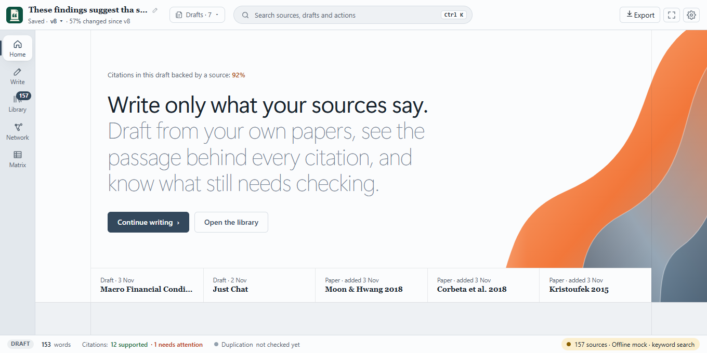

**Home** is where the app opens: one scrolling page with everything in one place. Nothing on it is a setting; every part is a way into the rest of the app.

- **The top** has one line that stays current (the share of the open draft's citations backed by a source), **Continue writing**, **Open the library**, and a row of what you had open or added last: your two most recent drafts and your newest sources.
- **Getting started** shows here, with a small drawing of the screen each step happens on, until its steps are done or you hide it. The same steps show above an empty draft in Write, and they tick off together.
- **Five tool cards** each show what's in that tool right now and open it when clicked: the open draft's first lines and one of its checked quotes (Write), the draft's citations counted as Check counts them, the papers you've highlighted most, the Network, and your review matrices.
- **The sample library** has a dark banner of its own. Once the demo is loaded it shows how many of its five steps you've done and opens the demo draft.
- **Your library at a glance** gives four numbers: sources (and how many are unread), highlights and notes, the share of the open draft's citations that are supported, and drafts. Each opens the place it counts.
- **Your topics** are a row of cards, largest first, with how many papers in each are unread. The arrows move along the row; a card opens that topic in the Library.
- **Pick up where you left off** has three tabs: **Drafts** (words and citations supported for each), **Recently added** (pages and highlights) and **Saved views** (the views you kept in the Library).
- **The foot of the page** lists the main actions with their keyboard shortcuts.

### The writing tools

The panel beside the draft has three tools, one for each job:

| Tool | What it's for |
|---|---|
| **Compose** | Writing with Muse. On top, **From your reading**: your highlights, best first for the paragraph you're in. Below, **Ask Muse**, one box with a switch: **Cite my sources** (Muse drafts from your library, every sentence cited and checked) or **Just chat** (Muse answers from its own knowledge, uncited). See [Compose](#compose). |
| **Check** | Everything that needs you, worst first. A summary at the top gives the share of citations backed by a source, counts them in the same words as the draft's marks, with a legend, and gives the duplication share; **How a citation gets checked** under the legend opens a short explanation of the four steps; then **Needs your attention**, **Still checking** and **Supported** (folded); then **Duplication**. The red number on Check is how many need attention. See [Back up each claim](#4-back-up-each-claim). |
| **Sources** | What the draft cites, one line per source that opens to its figures and its citations' marks; and the **Reference list**. See [Reference list](#reference-list). |

Versions aren't a tool: they open from **v8 ▾** under the draft's name (see [Versions](#versions)).

### Open and close the writing tools

The **>|** button at the top-right of the panel, beside its *Writing tools* title, or `Ctrl+\`, closes the writing tools and gives the page the room. A slim strip of their three icons stays on the right, with Check's count of what needs attention:

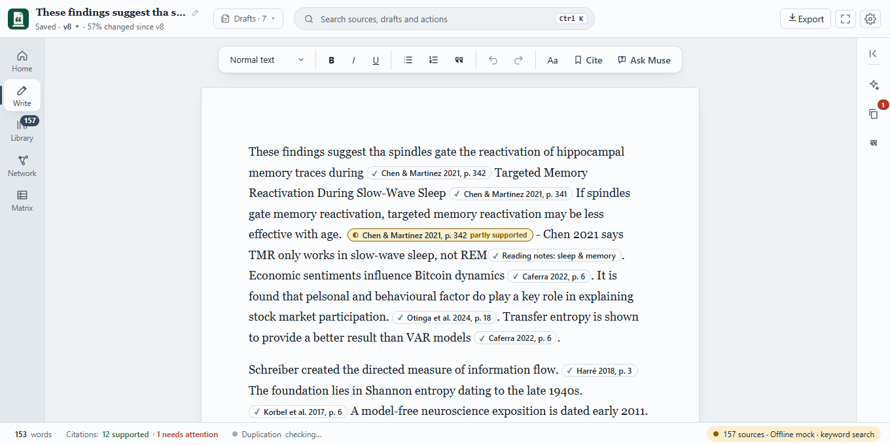

Click an icon to open that tool, or the **|<** button at the top of the strip (the same corner) to open the panel as it was. Anything that needs a tool opens it by itself: clicking a citation or a cite marker, a count in the status bar, or an action from Ctrl K. The app remembers whether you left it open; Settings can make it always start open or closed.

### Focus mode

The **⛶** button in the top bar, or Ctrl+Shift+F, hides everything but the page and its toolbar:

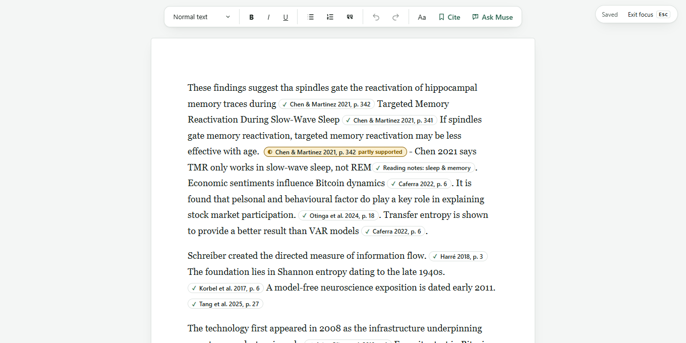

The save state stays in the corner. Esc, or **Exit focus**, brings the rest back.

## Try the demo

With a new library, **Getting started** shows on Home and above the empty draft in Write. If its first step says *Connect the AI*, the app is running on the offline mock, which matches words instead of reading them; **Add a Muse key** opens Settings at **AI model**. The status bar says so too: *Offline mock* shows in amber, and clicking it opens the same place.

**Try the sample library** (under *Add your sources*, or **Load sample library** in Ctrl K) adds six small files on sleep and coral reefs: two papers, reading notes, a fieldwork log, lab slides and a chapter outline. When they're in, the demo draft opens: four sentences from those papers, each with a cite marker that starts checking it at once. One sentence is false on purpose: the sleep paper found that reactivation during REM sleep did nothing, so Muse marks the claim that it helped as unsupported. (On the mock it may only be marked partial, or even pass.)

Above the draft, a checklist walks through the app, and each step ticks itself off when you do it. The button, tool or marker for the next step pulses:

1. **Confirm a source:** click a green marker, then **Use this source**.
2. **See the quote on its page:** click the citation that replaced it.
3. **Draft with Muse:** in **Compose**, with **Cite my sources** on, ask for a paragraph and insert it.
4. **Check for duplication:** open **Check**.
5. **Export to Word.**

**Reset demo** puts the draft back as it was written and clears the checklist, to run it again. **Remove samples** takes the sample files out of the library (they don't stay in *Removed* either) and deletes the demo draft; your own sources and drafts stay. **Hide** puts the checklist away; **Open demo draft** in Ctrl K brings it back. The sample files are copied into the data folder (`samples`) and read from there.

## 1. Add your sources

Open **Library** in the rail and click **+ Add sources**:

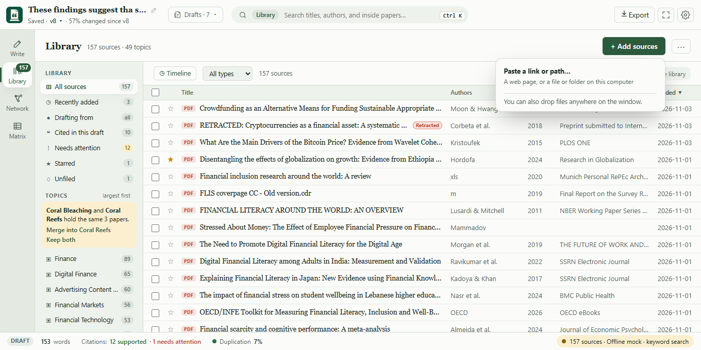

- **Files…** picks one or more files.
- **Folder…** adds every readable document in a folder and its subfolders.
- **Paste a link, DOI, title or path…** takes a web page address, a file or folder path on this computer, or a paper you don't have yet, by its DOI (`10.1257/aer.104.1.183`, `doi:…` or a `doi.org` link) or its title. A DOI or title is looked up in OpenAlex: when the title you typed matches a paper exactly, it's added straight away; when it only comes close, you're shown the match (**Is this the one?**) with **Add it**, and **Not it?** for the next two. Adding finds a free, legal copy and imports it. If there's no free copy, it says so, with **Publisher's page** to read it there; if the paper is already in your library, **Show it** takes you to it. A bare file name with an extension (`notes.pdf`) counts as a path, not a title.

You can also drop files anywhere on the window. A single Word file opens the [import dialog](#bring-in-a-word-file); anything else goes to the library.

The library reads PDF, Word (.docx), PowerPoint (.pptx), Markdown, plain text, HTML and images (PNG, JPEG, WebP). Scanned pages and images are read with OCR.

While files are being added, a card at the top of the library shows each file's stage, and each source appears in the list as soon as it's read (Muse takes about 15 seconds per file). Messages like "Added 6 sources" close by themselves after a few seconds; error messages stay until you click them. If you're somewhere other than the Library when an import finishes, the message shows in the notice bar at the top instead, with **Open the Library**.

Files are added in the background. A card under the Library's header shows each file's progress (reading, Muse reading it, filing into topics), and **Stop** cancels the rest. When Muse can't write a summary or tags (it's offline or rate-limited), the paper is still searchable and citable; it's marked *no summary yet* and the library offers **Try again**.

Your files stay where they are. The library keeps its own index in `~/.groundwork/`; only text passages, and images that need OCR, are sent to Muse.

## 2. Organize the library

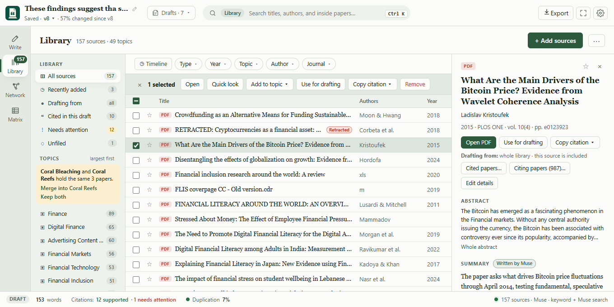

The library opens on its **folders**, the way a desktop shows a directory: your [topics](#topics), largest first, with the [smart folders](#smart-folders) above them. Open a folder and its papers show one line each, as in a mail app or a file explorer.

### The folders

- **Select a folder:** click it. The panel on the right sums it up: how many papers and which years, how much of it the open draft cites (green) and how much more is ticked for drafting (blue), papers by year, the newest titles, the most frequent first authors, and the topics it shares papers with (click one to open it). **Use for drafting** ticks all its papers for Muse, and **Map it** shows the topic in the [citation network](#the-citation-network).
- **Open a folder:** double-click it, press **Enter**, or click **Open** in the panel. A trail at the top, **Library › Topic name**, leads back; so do the ‹ button, **Backspace** and **Alt ←**, which return you to the folders with the one you left still selected.
- **Move between folders** with the arrow keys.
- **Peek inside:** press **Space** on a folder to list its papers without opening it. The arrows step to the next folder, **Enter** opens it, **Space** or **Esc** closes the list.
- **Right-click a topic** to open it, peek inside, give it a **colour** (five, or none), **rename** it in place, or **merge** it into another topic. The colour is kept with the topic in your library.
- **N cited** on a folder counts the papers in it that the open draft cites.
- **Recently opened**, at the top, holds the last few papers and folders you opened. Something removed or deleted since drops out of it.
- **Largest first** or **A–Z** orders the topics. **Folders** or **Rows** shows them as tiles or as a table, and the slider beside it sizes the tiles. The library remembers these choices.
- **Search** from the box at the top: on the folders, it finds topics by name and by the titles of the papers in them. **Search every paper instead** opens All sources with the same search, including the passages inside the papers.
- When two topics hold the same papers, or nearly, a note above the folders offers to **merge** them into the larger one. **Keep both** dismisses it for that pair.

### Inside a folder

A folder's papers show one line each, newest first. **Rows** or **Covers** (at the top right) switches to a grid of each paper's first page; the slider sizes them. A PDF's cover is its real first page, drawn as it scrolls into view; anything else, or a PDF whose file can't be found, gets a plain page with its title and authors. Covers select, open, peek and drag just as rows do.

- **Select:** click a paper. Its details open on the right: summary (marked **Written by Muse**: it's Muse's reading, not the paper's words), topics, keywords and JEL codes, [related papers](#related-in-your-library), DOI, link and file location. **Ctrl-click** adds or drops a paper, **Shift-click** selects through to it, the box in front of a row does the same as Ctrl-click, and **Ctrl A** selects every paper shown. With the list selected, ↑ and ↓ move between papers (hold Shift to select several) and Esc clears the selection.
- **Act on what's selected:** the bar above the list changes to **N selected** with **Open**, **Add to topic**, **Use for drafting**, **Copy citation** and **Remove**. **Right-click** a paper for the same actions, plus Mark as read or unread, Star, Edit details, Show in folder on disk, Cited papers and Citing papers.
- **Peek at a paper:** press **Space** for a [quick look](#quick-look) without opening it.
- **Open a paper:** double-click it, or press Enter. A PDF opens in the app's reader described below, a Word file, slides or an image in the app your computer opens it with, and a web page in your browser.
- **Find a paper:** type in the search box at the top. Every word has to match, in any order, anywhere in the paper's record: title, authors, journal, keywords, tags, JEL codes, topics and summary. Under the matching papers, **Inside your papers** lists passages from the papers' own text that contain all of your words, with the page each is on; click one to open the paper at that page with the words marked (the reader's Find box holds them, so ↑ ↓ there step through the paper's other matches). The page shown is the number printed on the paper, which can differ from the reader's own page count. The [filter chips](#filters-and-saved-views) above the list narrow it further.
- **Sort and columns:** click a column header to sort by it, and again to reverse; the library opens sorted the same way next time. Right-click the header row to choose columns: Authors, Year, Journal, Added, Cited by, Topics.
- **Unread and starred:** a paper you add is **unread** (bold, with a blue edge) until you open it; right-click to mark it read or unread yourself. Click the ☆ beside a title to star a paper you want to find again.
- **Copy a citation:** **Copy citation** copies the selected papers' references as APA, MLA, IEEE or BibTeX, or saves them as a `.bib` file.
- **Export a reading list:** **Export reading list…** in the selection bar, or on a topic's right-click menu, saves the papers as an annotated reading list in Word. Each paper gets its reference in your citation style (Settings), Muse's summary (marked as Muse's), and your highlights with their page numbers, each with your note under it. Order it **By author** or **By year** (oldest first); your own reading notes come last, under **Your notes**. It's made from what the library already holds, so nothing is sent to Muse.
- **Correct its details:** **Edit details** fixes the title, authors, year, journal, DOI or link. Reference lists are built from these, and your corrections are kept if the file is added again.
- **Read the whole PDF:** **Open PDF** in its details opens it in the app's reader, in a window of its own, where you can highlight passages and add notes (see [Highlights and notes](#highlights-and-notes)). It opens maximized; resize it, snap it to half the screen or move it to another monitor to keep it beside your draft, and it remembers that. The next paper you open replaces it in the same window. **Open in PDF viewer** at the top opens the file in Chromium's viewer instead, for thumbnails and print. The reader has its own page counter, zoom and search (see [Highlights and notes](#highlights-and-notes)). **Show in folder** finds the file on disk.
- **Remove:** select papers and press Delete, or choose **Remove**. They leave the list at once and a message offers **Undo** for a few seconds; closing the app in that time doesn't cancel the removal. The files on disk aren't touched, and afterwards you can still bring a paper back from **Removed**.

### Smart folders

The green folders with a ⚙ above your topics are filled by a rule, so they keep themselves up to date. One shows only while it has something in it, except All sources and Drafting from:

- **All sources**, and **Recently added** (the last 14 days).
- **Drafting from:** the papers Muse drafts from (see below).
- **Cited in this draft:** what the open draft cites.
- **Needs attention:** papers marked **Retracted**, papers with no year or author in their record (**Needs metadata**), and papers Muse still owes a summary.
- **Unread** and **Starred**.
- **Unfiled** (in no topic) and **Removed**.
- **File missing** (amber): papers whose file isn't where you added it from, because it was moved, renamed or deleted. Their text, citations and highlights are still in the library, so searching and citing them works; only opening the file doesn't. A paper's details say where it was, with **Locate file…** to point it at the file's new place (it keeps its citations, highlights and topics) and **Remove from library**. If the file you pick isn't the same one (its contents differ, say a revised version), you're asked first, since quotes and highlights were placed on the old one. Web pages are never missing.
- **Never used:** papers you've never opened, never cited (in a draft, a review matrix or a saved finding), never highlighted and haven't ticked for drafting: candidates to read, or to remove. Papers added before the app kept reading marks count as opened, so they don't show here.
- Every [saved view](#filters-and-saved-views) you make.

### Filters and saved views

The row of chips above the list narrows whatever folder you are in:

- **Type**, **Topic**, **Author** and **Journal** each open a list with the number of papers beside every choice. Tick as many as you like: within one chip the choices add up (PDFs *or* slides), and across chips they narrow (PDFs *and* by Suri). Authors and journals are listed with the most papers first; type a letter to jump to a name.
- **Year** takes one choice: the last 5 or 10 years, a decade, before 2000, or papers with no year in their record.
- **Has highlights** shows only the papers you have highlighted passages in. It appears once you have highlighted something.
- A chip that is set is filled in and says what it is set to; its **×** clears it, and **Clear filters** clears them all. The chips work together with the search box and the Timeline.

**Save as view** (at the right of the chips, once a chip or the search is set) keeps the search and the filters as a smart folder on the library's front page, with the folder you were in. A saved view stores the question, not the answer: its count and its papers are worked out each time, so "Last 5 years" moves on with the calendar and new papers join by themselves. The Timeline's range isn't saved.

- Open a saved view like any folder. Going back to the folders leaves it, and clears its search and filters.
- While it's open, **Rename** and **Delete** sit beside its name above the list; right-clicking its folder offers the same. Deleting a view never touches your papers, and the message offers **Undo**.
- Saving under a name that is already used replaces that view.

### Quick look

Select a paper and press **Space** (or choose **Quick look** above the list or in the right-click menu). A panel shows its first page, its abstract (or Muse's summary when there is no abstract) and the passages you have highlighted in it, with your notes.

- **↑ ↓** move to the next paper with the panel still open, so you can run through a list after a big import.
- **Enter** opens the paper; **Space** or **Esc** closes the panel and leaves the paper selected.
- Looking doesn't mark a paper as read.

### Related in your library

A paper's details list up to five papers in your library that are closest to it, each with the reason: **Cites this paper**, **Cited by this paper**, **N shared references** (works both cite), **Both on …** (keywords the two carry and most of your library doesn't) or **Similar wording** with the words. Click one to go to it; if a search or filter is hiding it, those are cleared.

The list comes from the papers' reference lists and the words in their titles, keywords and summaries. Muse isn't asked, so it's instant and works offline; the first paper you open after adding sources takes a couple of seconds while the references are matched.

### Topics

A topic is a subject, not a place on disk, so one paper can sit in several. Click the **New topic** folder at the end of your topics, type a subject (say, *Digital finance*) and pick how closely a paper must match it (50% by default). Every paper that matches is filed in.

Muse files papers by the topic's name. To be more precise, fill in **What belongs here** with a sentence or two in your own words, for example *Empirical papers on mobile money in East Africa, not policy reports*. Muse reads the whole rule, including what it leaves out. It's optional: a topic without one is filed by its name, as before.

- Open a topic to change its threshold with the slider, rename it or delete it, and to add or **Edit** what belongs there (under its name). Changing the rule files the topic's papers again, as renaming does; papers you added or took out by hand stay as you left them. The rule also shows in the panel beside the folders when the topic is selected. Papers stay in the library when a topic is deleted.
- Inside a topic, **Also in** beside each paper names up to two of its other topics (and **+N** for more); click one to open that topic.
- Add papers to a topic with **Add to topic**, or drag them: while you drag papers, a shelf of your topics appears along the bottom of the library, and dropping on one adds them to it. They stay in the topics they were already in. Take a paper out with the × on its topic chip in its details. Your own changes survive re-filing.
- **⋯ → Re-file papers into topics** scores every paper against your topics again.
- **Surprise me**, on a topic's right-click menu or under its summary beside the folders (and on **All sources**), opens a paper from it you haven't read yet, at random, in the reader: PDFs first, any paper when the topic has none. A message says which, and how many unread there were. When you've read everything in it, it picks from all of it and says so. **Surprise me** in Ctrl K does the same for your whole library. Papers added before the app kept reading marks count as read.
- **What's new**, in the panel beside the folders or in an open topic's bar, lists recent works that cite the topic's papers and aren't in your library, as OpenAlex knows them: the ones citing more of the topic first, then the newest, up to ten. Each says how many of the topic's papers it cites (point at it to see which). **Get a free copy** finds a free, legal copy and adds it to your library and to the topic; **Get free copies of all** does the whole list, three at a time. When there's no free copy, **Publisher's page** opens the work at its publisher. It only asks OpenAlex when you press it (one request per 50 papers, for a topic's 100 most-cited papers at most), and keeps the answer for a few hours; **Check again** asks afresh. Works citing a paper that hasn't been looked up in the index can't be found: a note says how many, and **Look them up** does it.

### Pick the sources to draft from

Muse drafts (Compose, Cite my sources) and searches for citations in your whole library, unless you narrow it: select papers and choose **Use for drafting**. Those papers get a green dot, and the **Drafting from** folder lists them; **Use for drafting** on a folder's summary ticks all of its papers. The bar above the list says **Drafting from: whole library** or **Drafting from: N of M**, and **Use whole library** clears the choice. A paper's details say the same, and whether that paper is included. A red **Retracted** pill (OpenAlex lists the paper as retracted, or its title or keywords say so) or an amber **Needs metadata** flag (no year or author in its record) warns you before you rely on a source; both also show in Network, Sources and the reference list, and a retracted paper's citations are flagged in the draft (see [Back up each claim](#4-back-up-each-claim)).

### Timeline

**◷ Timeline** above the table opens a date slider with a bar for each month showing how many sources fall in it. A library that spans more than 15 years is shown year by year.

- **Added** goes by when you got each file: its date on this computer, or the day you added it here if that is earlier. Drag the two handles to a range, or click a bar to jump to that month.
- **As of** uses one handle and shows your library as it was at the end of that month. Sources removed since then are listed greyed out at the bottom. Open one to restore it.
- **Published** goes by publication date. Papers known only by year show as lighter bars spread across that year. **Look up exact dates** looks the papers up in OpenAlex and Crossref (see below), which gives the full date and fills in the DOI of papers that have none.

### Removed sources

Removing a source, yourself or from Find duplicate files, keeps a record of it under **Removed** once the Undo message has closed: when it was added, when and why it was removed (and which copy was kept, for a duplicate), and whether its file went to the Recycle Bin. **Restore** reads the file again and brings it back under its old id, so drafts that cite it work again, with its old added date, your corrections and your topics. If the file has moved or gone to the Recycle Bin, put it back first. If you add a file you removed before, its details say so. **Forget this record** clears the entry.

### More library tools (⋯)

- **Find duplicate files:** copies of the same paper, with what you could free up. It suggests what to keep and can move a copy to the Recycle Bin; it never deletes outright.
  - For two files of the same paper in different versions (**Likely same paper/version**, a preprint and the published version, say), **Keep the published version and move everything to it** keeps the one with a DOI or journal and moves everything from the other to it: its citations in every draft, its review-matrix rows, saved findings, highlights and notes, the topics you put it in and its star. Then the other copy is removed (it's listed under **Removed**, as a duplicate of the one kept). When it isn't clear which is published, each copy offers **Keep this one and move everything to it**. You're shown what will move before anything does.
  - Each moved citation's quote is found again in the copy kept. One that can't be found word for word stays in your draft, marked **Not supported** with a note to check it, so it's never pointed at the wrong passage. A matrix cell like that becomes unverified, and a highlight keeps its text and note but loses its place on the page. A version of each draft is saved first, so **Versions** can take a draft back; highlights, topics and matrix cells can't be undone that way.
- **Most-cited papers you don't have:** what your papers on a topic cite most that isn't in your library, with free copies to download where one exists.
- A paper's **Cited papers…** button lists the works it cites and downloads free copies of them. Entries marked "from OpenAlex" weren't found in the paper's own reference list.
- A paper's **Citing papers…** button lists newer works that cite it (from OpenAlex), the most cited or the newest first, with their abstracts and free copies to add: **Find free copy** for one, or **Get free copies of all** for every one listed that isn't in your library yet (three at a time; **Stop** halts it).
- **Look up papers in scholarly indexes:** fetches the publisher's details (journal, volume, issue, pages), the authors' abstract, the reference list and the citation count for every paper not looked up yet; once all are, it refreshes them. New imports are looked up automatically unless you turn that off in Settings → Library. What you corrected yourself is never changed. If the DOI on a paper belongs to another work, nothing is taken and its details tell you.

## 3. Write a draft

Click **Write** in the rail. The draft is saved as you type; the top bar says *Saving…* and then *Saved*.

### Drafts

Click **Drafts** beside the draft's name in the top bar for your drafts:

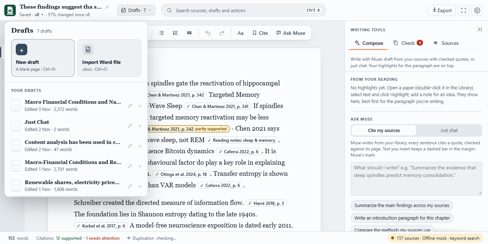

From there you can start a **New draft** (Ctrl+N), **Import a Word file** (Ctrl+O), switch to another draft, rename one with its pencil, or delete one with its ×.

**Name a draft:** click its name in the top bar (or use the pencil in the drafts menu), type a name and press Enter; Esc cancels. Until you name it, a draft is called after its first line, shown in grey italics so you can tell it isn't a name yet. A name you give stays when the text changes, and it's the file name when you export. Clear the name to go back to the first line. A draft opened from a Word file or written as a proposal starts with that file's or proposal's name.

### Bring in a Word file

Ctrl+O, the drafts menu, or dropping a .docx on the window opens a preview of what was read. Choose where it goes:

- **A new draft**,
- **into the open draft** (at the cursor, or at the end if you haven't clicked into it; Ctrl+Z takes it out again), or
- **the library**, as a source you can cite.

Headings, lists, quotes, bold, italic, underline, strikethrough, links and line breaks come across. Tables become one line per row and images are left out; the preview says when that happened.

### Compose

**Compose** is where you write with Muse. **Ask Muse** has one box and a switch above it:

- **Cite my sources** drafts from your library. Type what you want (or pick an example) and click **Draft with citations**. Every sentence comes with a quote from a source, and each quote is checked in the background.
- **Just chat** is a plain chatbot (see [Just chat](#just-chat)).

Every citation, here and everywhere else in the app, says what its check found with the same symbol and the same word:

| Mark | Meaning |
|---|---|
| ✓ **Supported** (green) | The quote is in the source and supports the sentence. |
| ◐ **Partly supported** (amber) | The quote is there but only partly supports it. |
| ✕ **Not supported** (red) | The source doesn't back the sentence, or the quote is no longer in it (its reason says which). |
| … **Checking…** (grey, dashed) | Not checked yet. |
| blue, square mark | Written from a review matrix and checked against the whole matrix (see [Review matrix](#review-matrix)). |

The chip in the draft says *partly supported* or *not supported* after its label, so the ones that need you stand out; supported ones stay quiet. The legend at the top of **Check** shows them all.

While it drafts, Compose counts the seconds (it usually takes 10 to 30) and says why when it's slower: Muse is busy and retrying after a rate limit. **Cancel** stops waiting; nothing is added to your draft (Muse may still finish in the background, and that answer is dropped).

Click a citation to see its passage. Tick the sentences you want to keep (or click a sentence; **Select all** ticks every one), then **Insert N selected** puts just those in, in the draft's order, at the cursor, or at the end if you haven't clicked into the page yet.

**What Muse wrote stays marked.** Text Muse wrote (a draft from your sources, sentences written from highlights or a matrix, a chat reply you insert) has a faint tint and a dashed bar in the margin of its paragraph; point at it for *Written by Muse*. Words you type, even in the middle of it, aren't marked, so the mark keeps to Muse's own words. It's saved with the draft and isn't exported.

### Highlights and notes

**While reading.** Open a PDF (double-click it in the Library, or **Open PDF**). Select text on a page and a small bar appears:

- **Highlight** marks it in yellow. It stays on the page every time you open the paper.
- **Add note** highlights it and opens a note for an idea you have while reading. A ✎ mark in the margin shows a highlight has a note.
- **Insert in draft** puts it into your draft at the cursor as a quote, citing this page. It's the paper's own words, so the citation is marked supported; click it like any other to see it on the page. From the reader's own window it goes into the draft in the main window.

Click a highlight to read or change its note, or **Remove highlight**. A highlight has to be on one page. Scanned pages without a text layer can't be selected.

**Highlights · N** at the right of the toolbar lists the paper's highlights in page order, with your notes; it opens by itself when the paper has some. Click one to scroll to it, and it flashes on the page.

**Getting around.** The toolbar under the title:

- **Page 3 of 12** follows as you scroll. Type a number and press Enter to jump; **‹ ›** turn pages.
- **− 100% +** zooms the pages (50–300%). 100% is a comfortable reading width; **Fit width** stretches the page to fill the window. Ctrl + and Ctrl − zoom, Ctrl 0 goes back to 100%. The page you were on stays in view, and pages are drawn again sharp at each size.
- **Find in this paper** (Ctrl F) counts the matches, *2 of 7*. The current one is marked in orange and the page's other matches more lightly. Enter or **↓** goes to the next, Shift+Enter or **↑** to the one before, and Esc clears it.

**While writing.** **From your reading**, at the top of **Compose**, lists what you highlighted, with your notes, best first for the paragraph your cursor is in. It ranks again by itself when you move to another paragraph or come back from the reader's window (not while you have some ticked). The first three show; **Show all N** lists the rest. The ranking runs on your computer, with nothing sent anywhere.

- **Insert quote** puts the highlight into the draft as a quote with its citation, already verified, because it's the paper's own words.
- Tick a few and **Write from N**: Muse writes sentences from them, following on from your draft and guided by your notes. They're cited and checked like any draft from your sources, and you tick the ones to insert. **Tick all** ticks every one.
- Click a paper's label to open it at that page.

Your notes are your own ideas: Muse may use them as guidance, but they're never cited as a source. A highlight whose text the app can't find in the paper's stored text (rare, mostly odd layouts) is listed but can't be cited.

### Just chat

**Just chat**, in Compose's **Ask Muse**, is a plain AI chatbot: ask it to explain a concept, reword a sentence, suggest a title, or anything else. Type a message and press Enter (Shift+Enter starts a new line). It remembers the conversation, so follow-ups work, and it also sees the paragraph your cursor is in.

It answers from Muse's own knowledge, not your library, and its replies have no citations: check facts before you rely on them. To write from your sources with cited quotes, switch to **Cite my sources**.

To ask about part of your draft, select it and press **Ctrl J**, or click **Ask Muse** in the toolbar beside Cite. Compose opens on Just chat with the text attached above the message box (× removes it).

Replies show formatted (bold, lists, headings, tables, code). **Insert into draft** under a reply puts it at the cursor with that formatting.

Each draft keeps its own chat, also after you close the app; **Clear conversation** at the top of the chat starts it over.

While Muse answers, the chat counts the seconds and says why when it's slower (Muse busy and retrying, or switched to Meta's API). **Cancel** stops waiting and puts your question back in the box; if Muse still answers, the reply appears the next time the chat loads.

## 4. Back up each claim

Put the cursor in a sentence you wrote (or select some text) and press **Cite** in the toolbar, or Ctrl+Shift+C. A small grey `cite` marker appears at the end of the sentence and you keep writing; the search runs in the background and the cursor doesn't move.

Two searches start at once: a quick keyword search for the sentence as written, whose passages are checked straight away, and the full search that Muse expands and ranks. The marker turns green with a ✓ as soon as one source is found that supports the sentence (*Source found, confirm it*), often from the quick search within a few seconds, without waiting for the other candidates: click it and you can confirm that source at once, while the rest are listed as *Checking…* until their checks finish. The list is the full search's four candidates, plus any other supported source the quick search found. It turns amber with a ◐ when it's only partly supported, red with a ✕ when what was found doesn't support it, and red with a ? and a dashed border when nothing in your library matches (*No source found*). The symbol says the same as the colour, so it reads without colour too, and a screen reader hears it in words. The marker never changes size, so the line you're typing doesn't shift.

Click a marker to open **Check** with what was found. **Use this source** turns the marker into a citation (Ctrl+Z undoes it). You can also search again for a reworded sentence, or **Remove marker**.

Citations carry the same symbols and words: ✓ Supported, ◐ Partly supported, ✕ Not supported, and … Checking… while one is being checked. Blue ones, with the ✓ in a square, were written from a review matrix.

A citation of a **retracted** paper is red with a ⚠ and the word *retracted*, whatever its quote's check found. Pointing at it says the source has been retracted and who says so: OpenAlex, or the paper's own title or keywords. The app asks OpenAlex when it looks a paper up (see Settings), so a paper retracted after you cited it is flagged the next time it's looked up. A lookup that fails never clears the flag. You can still cite a retracted paper, for instance to write about the retraction; the warning just makes sure it isn't by accident.

**Check** counts them all one way, the way the status bar and Check's badge do: a citation **needs attention** when it's partly or not supported or cites a retracted paper, and so does every marker whose search has finished (it found a source for you to confirm, or found nothing); one is **checking** while its check or search is still running. The summary at the top says how many need attention out of how many, with a bar (green supported, red flagged, amber a source found and waiting for you to confirm it, grey checking) and the legend. Then:

- **Needs your attention:** citations of retracted papers first (**Cites a retracted paper**), then markers waiting for you, then citations that aren't fully supported, each with the reason Muse gave. **‹ ›** step through them in the draft.
- **Still checking:** markers still searching (each says **Finding a source…** or **Waiting its turn**; three are checked at a time) and citations being checked.
- **Supported:** folded away; click to see them.

Click a row, or **See quote ›**, to see its quote on its page, as clicking the citation does; **Show in draft** selects it in the draft and **Check again** checks it against its sentence as it reads now. Clicking the citations count in the status bar opens Check.

### Recheck every citation

After rewording sentences, or adding and removing sources, press **Recheck all** in Check's summary, or pick **Recheck all citations** from Ctrl K. Each citation's quote is found in your library as it is now and checked again against its sentence as it reads now. Blue citations, written from a review matrix, are checked against the matrix instead. Every `cite` marker searches again. Citations turn grey while they're checked and you can keep writing. When it's done, a note says how many were supported and how many weren't. If the backend didn't answer for a citation, it keeps its earlier result.

### See the quote on its page

Point at a citation to see what backs it: its verdict, the quote and Muse's reason. Click it and **Check** shows its passage highlighted on the page, and a dashed line joins the citation to the quote:

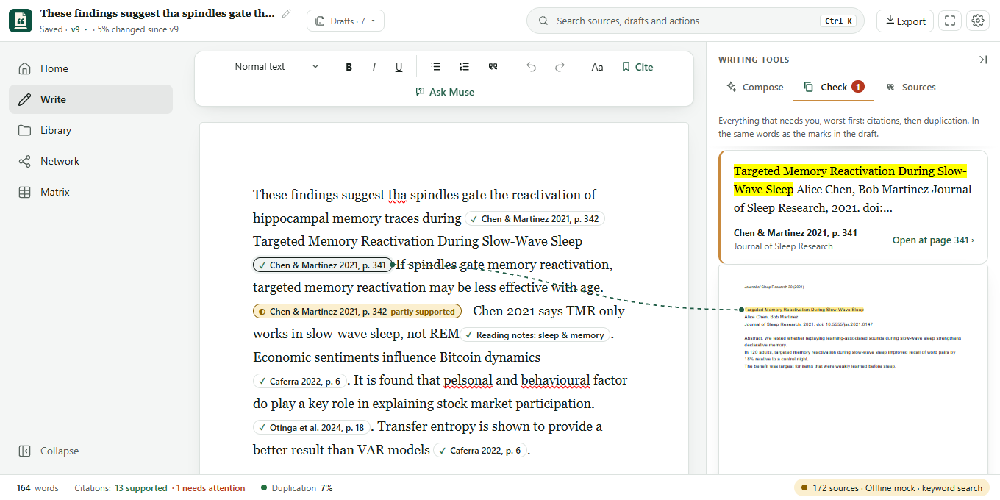

For a PDF you see the page as it's printed, with the quote highlighted on it. **Text** switches to the text read from the page (handy for small print, and what other kinds of source always show); **Page** switches back, and the app remembers your pick. If a quote can't be placed on the page image (a scan, say), the text is shown instead, with a note.

Above the page, a card gives the passage in the source's own words, with the matched part marked and a little of what's around it. The page line gives both numbers when they differ: the printed page (p. 342) and the PDF page (2 of 2). The arrows turn pages. **Open at page 342 ›** on the card opens the PDF in its own window at that page:

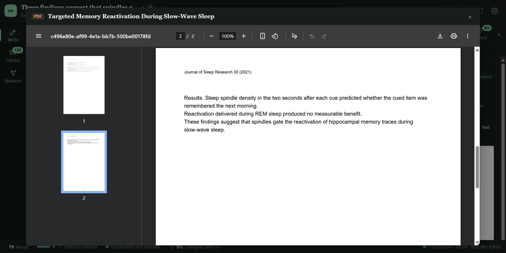

Close that window as you would any other. **‹ Back** returns to the tool you came from.

### Reference list

**Sources** lists the sources the draft cites. **Cited sources** gives each one a line that says how it's used (*Chen & Martinez 2021 is cited three times; two are supported.*); point at the line for the breakdown. Click the line, or its **+**, to open it: how many citations and how many are supported, **Open paper ›** for its details in the Library, and a mark for every citation (click one for its quote). The first source is open to begin with. Sentences still waiting for a source are listed last as **No source yet**. Your own reading notes come after the papers, with a grey mark and a grey **Your note** pill, in both Cited sources and the reference list, so they aren't mistaken for published papers. **Reference list** lists them as soon as it opens (**Rebuild** builds it again), in the style chosen in Settings: APA 7, MLA 9 or IEEE. **Copy** copies the list, and **Copy as BibTeX** copies the same sources as BibTeX entries for a reference manager or LaTeX.

## 5. Check the draft

### Duplication

The draft is checked in the background as you write, for sentences that repeat each other and for text that matches a source closely, cited or not: once when it has text, and again after your edits settle (sooner while Check is open; **Re-check automatically** in Settings turns the re-checks off). The share is in the status bar and in Check's summary; **Duplication**, under the citations in **Check**, has the details:

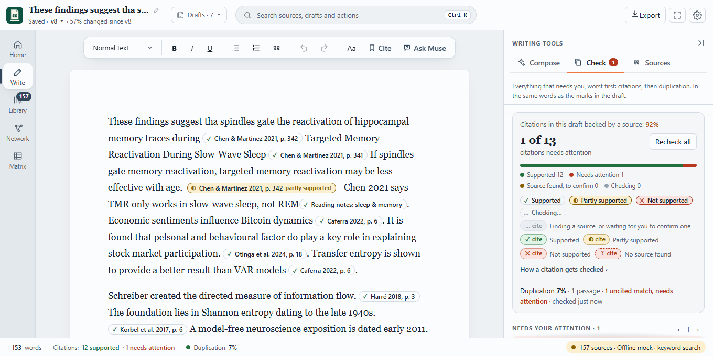

While Check is open, matching passages are underlined in the draft: red for an uncited match, dotted for a cited one, wavy for a repeat. Click a finding to jump to it, or its source to see the matching passage. If a check fails, **Check now** in the summary runs it again.

### Versions

**v8 ▾** under the draft's name (or **Versions ▾** before the first one) opens the draft's versions; the number beside it says how much changed since the newest. Snapshots are taken automatically as you write; **Save a version** makes a named milestone (say, *Sent to advisor*). Pick a version to see what changed, by document, section or paragraph, each with a percentage. **Restore** brings an old version back and keeps a snapshot of the draft as it was first, so nothing is lost.

## 6. Export

**Export** in the top bar saves the draft as a Word file. Citations are written in your citation style with a reference list at the end. A citation that didn't pass the check gets a Word comment saying why, every citation of a retracted paper gets one saying it was retracted, and a `cite` marker you haven't confirmed is left out of the text with a comment on its sentence.

## The citation network

**Network** in the rail shows your papers as a graph. It starts by asking what to show, since laying out a whole library at once can keep the window busy for a long time:

- **Map this topic:** type a topic there or in the search box at the top. You get the papers about it and the works they cite that you don't have.
- **Map the papers you're drafting from:** the papers under **Drafting from** in the Library.
- **Map the whole library:** every paper. Above 60 papers it warns that this can take a while.

**Change** next to the counts goes back to choosing.

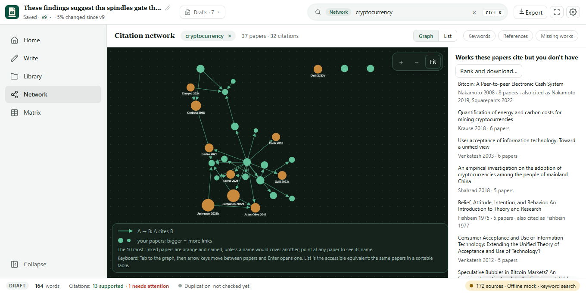

The graph is drawn on a dark panel in both the light and the dark theme. The ten most-linked papers are orange and carry their names; the others are pale blue.

- An arrow from A to B means A cites B. Grey lines join papers that share references, and dashed amber lines (Shared keywords) join papers with keywords in common. The checkboxes at the top turn each kind on or off.
- Dashed circles are works that several of your papers cite but that aren't in your library. They're off at first, since a topic can bring dozens of them; the list beside the graph names them either way, and **Missing works** draws them.
- The ten most-linked papers are named on the graph; point at any other paper to see its name and a card with its title. **+**, **−** and **Fit** (top right) zoom, as does scrolling.
- Click a paper to highlight its neighbours and list what it cites, what cites it, and what it shares. **Open in library** jumps to it.
- Click a line to see why its two papers are linked: which cites which, the works both cite (as far as this map shows them), or the keywords they share.
- **Graph | List** at the top switches to a table of the same papers: year, how many of the mapped papers cite each one, how many works it cites, and how many papers it shares two or more references with. Click a heading to sort, and a title to open the paper beside the table, as clicking its node does. The table works with the keyboard and screen readers.
- While the reference lists are read, the map says so and counts the seconds; **Cancel** goes back to choosing. A big map then shows *Laying out N papers…* while it's drawn.
- Turning a layer on or off keeps the papers where they were, so you don't lose your place. The count at the top says how many pairs share two or more references, which is when a grey line is drawn.
- In the list of works you don't have, a work cited under several years or authors is listed once, naming the other versions.
- **Rank and download…** lists the works the papers shown cite but you don't have, with free copies to fetch. Clearing the search box goes back to choosing what to show.

Esc returns to the draft.

## Review matrix

**Matrix** in the rail builds a literature review matrix: one row per paper, one column per question (sample, setting, method, findings, limitations, or your own), the table systematic reviewers fill in by hand.

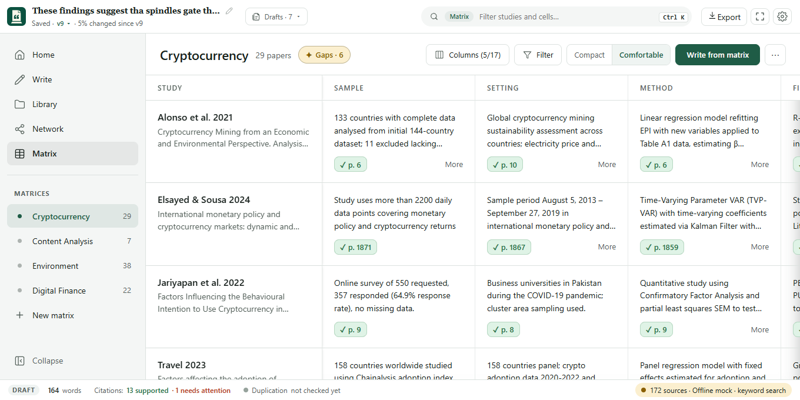

**Make one.** Click **+ New matrix**:

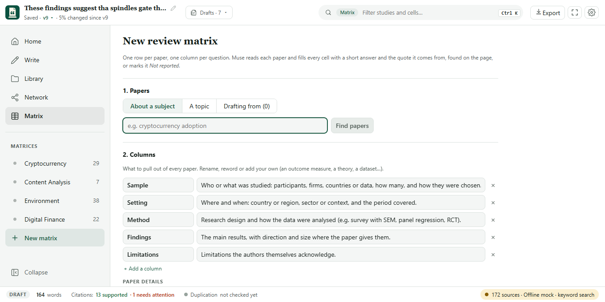

1. **Papers:** those *about a subject* you type, those in *a topic*, or those you are *drafting from* in the Library. Untick any you don't want (at most 80; copies of the same paper are offered once).
2. **Columns:** the standard five questions, which you can rename, reword or remove, and add your own: an outcome measure, a theory, a dataset. Each has a sentence saying what to extract. Under **Paper details**, switch on details from each paper's record (Year, Journal and Cited are on to start with; also Authors, Published, Volume (issue), Pages, Publisher, DOI, Abstract, Keywords and JEL codes).
3. **Build the matrix.** Muse reads several papers at once (about a minute for 30) while you keep working; cells fill in as they're read, and the progress bar says about how long is left. If you're in another place in the app or another window when it finishes, a desktop notification says so. **Find gaps** and **Write** show how long they've been working, and why when Muse is slow.

**Every cell rests on a quote.** For each paper, the app finds the passages that best answer each column (and the opening, where abstracts say most); Muse writes a short answer from them and copies the sentence it used. The app then finds that quote in the paper:

| Cell | Meaning |
|---|---|
| answer with a ✓ and a page | the quote was found on that page; click the page to open the PDF there |
| answer with an amber **Needs check** pill | the quote wasn't found in the paper: check it before you rely on it |
| *Not reported* | the passages read don't say; nothing is guessed |

Answers say only what their quote shows, so they can be checked; a fuller answer spread over several passages is cut to the part the quote covers.

**Check and correct.** Click a cell to open it beside the table, with its quote highlighted on the PDF page:

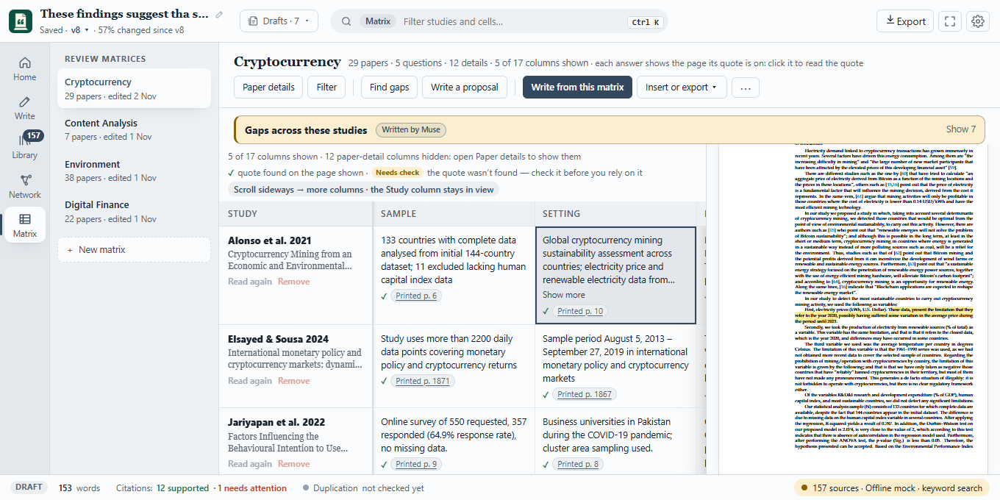

Edit the answer and **Save answer** (it keeps its quote as evidence), **Read again** to have Muse redo that cell, or **Open PDF** at the page. Hover a paper's name for **Read again** (the whole row) or **Remove**. Click a question's heading to rename it, change what it asks (it's read again for every paper, except answers you wrote) or remove it; **⋯ → Add a question** adds one. The search box at the top filters the rows.

**Use it.**

- **Find gaps:** Muse reads the finished matrix and names what the studies leave out (populations, places, periods, methods) and where their findings conflict, naming the studies each gap rests on. They're listed in one box, **Gaps across these studies**, above the table, marked **Written by Muse** (it isn't checked against a quote, so read the studies before citing it). The box starts folded so the table shows first; **Show** opens it. Each study a gap names is a link to that study's row. **Insert into draft** beside a gap puts it in the draft, citing every paper in the matrix. Running Find gaps again updates that box: the wait shows inside it, new gaps are marked **New**, and gaps the new run didn't find are removed, except those a draft (or a saved version of one) cites. Those stay, greyed and marked **In your draft**, so their citations can still be checked against the matrix.
- **Write from this matrix:** Muse writes a comparison of the studies from the matrix's quotes, each sentence citing them. Tick the sentences to keep and insert them into the draft.
- **Kept with the matrix:** every gap and every written passage keeps a copy of the rows it came from. Passages you insert are listed in the same box under **Written from this matrix**. The box shows when the matrix has changed since one was written, and you can insert one again or delete it.
- **Write a proposal:** plans a study that addresses the gaps (see [Write a research proposal](#write-a-research-proposal)).
- The toolbar above a matrix groups its actions: **Paper details** and **Filter** change what you see; **Find gaps** and **Write a proposal** analyse it; **Write from this matrix** is the main action, and **Insert or export ▾** holds the rest.
- **Insert into draft** (under **Insert or export**): the matrix as a table at the cursor, with the columns you choose. Each cell cites its quote, so the paper joins the reference list and the Word export; the citations are checked in the background, like the Assistant's. In the draft, **−Row**, **−Col** and **×Table** appear in the toolbar while the cursor is in a table.
- **Export** (also under **Insert or export**): an *Excel workbook* or *CSV* (each column's answer, then its evidence: page and quote), or a *Word table* whose cells cite their sources in your citation style, with a reference list.

**Paper details.** Detail columns show each paper's record as it is in your library: what OpenAlex and Crossref found (see [More library tools](#more-library-tools-)) and what you corrected under Edit details. They aren't read by Muse, so they fill in at once, cost nothing, carry no quote, and change when the record does. **Paper details** above the table adds or removes them (questions are limited to 12, details aren't).

- **Sort:** click a detail's heading: years and citations go newest or most first, then the other way, then back to the order they were added. Papers without that detail go last.
- **Filter:** **Filter** narrows the rows by a detail: years or citations between two numbers, or a journal, author or keyword containing a word. Filters add up, each shows as a chip (× removes it), and papers without the detail are left out while it applies.
- They're used too: **Find gaps** and **Write from this matrix** are told each study's details (e.g. that no study is after 2018, or that the most cited one disagrees), though only quotes are cited. The Excel, CSV and Word exports and **Insert into draft** include them as plain columns.

Matrices are saved with your library; **⋯ → Delete this matrix** removes one (the papers stay).

**Citations from the matrix are blue.** A gap or a written passage often compares several studies or says what none of them covers. One quote can't back a sentence like that, so its citations aren't checked against their quotes. Muse checks the sentence against the whole matrix: each study's answers and the quotes behind them. Blue means the matrix supports it; amber or red means it doesn't, with the reason. Click a blue citation to see:

- the gap or passage it came from, and the matrix rows it rests on;
- a note if the matrix has changed since, or was deleted (checks then use the copy kept with it);
- **Check against the matrix**, which uses the sentence as it reads now, and **Open matrix**;
- for a written passage, **View quote** and **Check against the quote…**, which warns first that one passage will probably show weak or no support for a sentence written from the whole matrix.

**Recheck all citations** checks blue citations against the matrix too. In the Word export, a gap's citations name each paper without a page, the papers join the reference list, and blue citations get no comment.

### Write a research proposal

**Write a proposal** above a matrix (or *Write a research proposal* in Ctrl K) plans one study that addresses the gaps you found, in four steps:

1. **Gaps:** tick the gaps to address, from one matrix or several. Ticking more than one matrix draws on several reviews, and a paper in two of them counts once. You can also say what the study should focus on, or write a focus instead of ticking gaps.
2. **Variables:** Muse suggests the variables such a study would use, most central first, each with a likely role and how the reviewed studies measured it. Only three start switched on: the outcome, its main cause and the next most central one, which makes the simplest study. Give any other a role (independent, dependent, mediator, moderator or control) to use it too, add your own, and say how you'd measure each if you know. Muse uses the fewest of the ones you switch on that answer the study's question.
3. **Limits:** what you don't want (one per line, e.g. *No randomised trials*), which Muse treats as strict rules, and what you have to work with (data, time, budget, skills). Both start with your last answers.
4. **Proposal:** Muse first plans one study, as simple as the gaps allow: a short, plain title naming the outcome and its main cause, a core question, usually one or two research questions (at most three), and which gaps fit. A mediator or moderator comes in only when a chosen gap is about one. Gaps that would make it a second study are left out, and you're told which and why. A separate Muse call then reviews the study's focus: it strips from the title and core question anything there only to bring in another topic, and keeps, revises or removes each research question against the core question (another outcome, population or kind of data is another study; a question that strings together controls is cut down to one relationship). You see what it changed. Only then is the rest written, around the questions that remain, and checked against what you ruled out. While it works (usually 1 to 3 minutes), the dialog shows which of the five steps is running: planning, reviewing the questions, writing, checking against your limits and the matrices, and rewriting what the matrices don't back. If you switch to another window, a desktop notification says when it's ready. If it breaks a rule you see where, with **Write it again without these**. **Has this been done?** searches OpenAlex for published studies close to the first research question, marking any already in your library. **Open as a new draft** opens it in the editor.

The draft has a title and Background, The gap, Research questions, Hypotheses, Variables (a table: the role, how the reviewed studies measured each variable and how this study will), Design, Data, Analysis, Contribution, Limitations and Timeline. Only what describes the reviewed studies cites them (background, the gap and the earlier measures), with blue citations, each checked against the matrix rows of the studies it cites. A paragraph those rows don't back gets one repair: Muse rewrites it from the rows and the check's reason, and the rewrite replaces it only if it's better backed (one the rows contradict, and nothing can be saved of, is taken out). The dialog lists what was rewritten and what still isn't fully backed, with Muse's reasons. A measure the matrices don't state is taken out of the Variables table rather than left in red, and listed too. Everything from the research questions on is proposed for your study, so it cites no one. A note under the title says so, to delete when you no longer need it.

## Keyboard shortcuts

| Keys | What it does |
|---|---|
| Ctrl K | Search everything and run any action |
| Ctrl N | New draft |
| Ctrl O | Import a Word file |
| Ctrl Shift C | Cite the sentence at the cursor |
| Ctrl J | Ask Muse about the selected text (Compose, Just chat) |
| Ctrl \ | Open or close the writing tools |
| Ctrl Shift F | Focus mode on or off |
| Ctrl Z / Ctrl Y | Undo / redo in the draft |
| Esc | Leave focus mode; close the PDF viewer or a menu; clear the search box; leave Home, the Library or the Network for the draft |
| Arrows / Enter / Space | On the library's folders: move between folders / open one / peek inside it |
| Backspace or Alt ← | Inside a library folder: back to the folders |
| ↑ ↓ | Move between papers in the library list (when it has focus); with Shift, select several. With covers, ← → also move |
| Enter / Delete | In the library list: open the selected paper / remove the selected papers (with Undo) |
| Space | In the library list: quick look at the selected paper; ↑ ↓ move on, Space or Esc closes |
| Ctrl A | In the library list: select every paper shown |

On a Mac, use Cmd in place of Ctrl.

## Settings

The gear in the top bar opens Settings. Changes apply as you make them and are kept in your library, so they follow it; the footer at the bottom says so (the AI model section is the exception: it saves with **Save and switch**). The section list and the open section scroll separately.

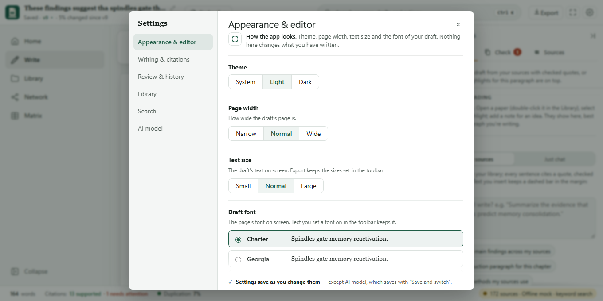

**Appearance & editor**

- **Theme:** Light, Dark, or System (follows your computer).
- **Page width**, **Text size** and **Draft font** (Charter, Georgia or sans serif): how the draft looks on screen. Fonts and sizes you set on text in the toolbar keep theirs, and Word export uses the toolbar's.
- **Spelling:** underline misspelled words, or not.
- **Writing tools at start:** as you left them, always open, or always closed.

**Writing & citations**

- **Citation style:** APA 7, MLA 9 or IEEE, for the reference list in Sources and for Export.
- **Passages Muse drafts from** (3 to 20, default 8): fewer is faster and sticks to the closest matches; more covers more ground.
- **Cite markers search:** the sources under **Drafting from** in the Library (all of them when none are chosen), or always the whole library.

**Review & history**

- **Duplication sensitivity** (30–90%, default 50%): a sentence is flagged when at least this share of its wording is found in a source. Lower catches more paraphrase; higher flags only near-copies. It applies from the next check.
- **Re-check automatically:** check duplication again after edits settle.
- **Automatic snapshots:** at most every N minutes (default 10), and **Snapshots to keep** (default 40). Versions you name are always kept.

**Library**

- **New topics start at** a similarity of N% (default 50%).
- **Contact email** (optional): sent to OpenAlex, Semantic Scholar and Crossref when finding free copies of cited papers.
- **Look papers up in scholarly indexes** (on by default): after an import, each paper's DOI or title is sent to OpenAlex and Crossref for its journal details, abstract, reference list and citation count.
- **CORE API key** (optional): with a key (free from core.ac.uk/services/api), free copies are also searched for in CORE, which gathers full texts from university repositories. The key is checked with CORE before it's saved.

**Search**

- **Now:** keyword (BM25) search and a small search model, bge-small, on this computer find the matching passages (it uses your graphics card when there is one, and shows how much of your library it has read), a second small model reranks them, and the AI model — Muse Ember, Meta's efficient model, through Meta's Model API, or the offline mock — expands the search and puts the best first. (Writing and checking use Muse Spark.) The two search models are open models, not Meta's: they download once on first start, run on this computer and never send your papers' text anywhere. Until they have loaded, search uses keywords and Muse alone.

**AI model**

- **Model:** Muse (through Meta's Model API), or the offline mock (no key; rough results). **Save and switch** changes it at once, with no restart.
- **Meta Model API key:** paste a key to save or replace it. It's written to the `.env` file in your data folder and never shown again; only its last four characters are, so you can tell which one it is.
- **Reasoning effort:** how much Muse thinks before answering, from *minimal* (fastest) to *xhigh* (most thorough). *low* is the default. Citation support checks always run at *low* whatever you choose here, so Cite and Recheck all stay quick.

If one of these is also set as a system environment variable, Settings says so: that value wins the next time the app starts.

## Troubleshooting

| What you see | What to do |
|---|---|
| *Backend offline, reconnecting…* | The backend stopped; the app restarts it by itself (up to 3 times a minute). Hover the message for the log file's location. |
| *Restart the app to finish updating* | The backend is older than the window. Close and reopen the app. |
| *Something went wrong* fills the window | The app hit an error drawing the window. Click **Reload**: drafts are saved as you type, so your work comes back. |
| The library is damaged, or you need it as it was | The app copies the library once a day when it starts, into `~/.groundwork/backups/`, keeping the newest three. Close the app, replace `~/.groundwork/library.db` with a copy, and delete `library.db-wal` and `library.db-shm` beside it. |
| Starting the app again shows the window that's already open | Only one copy runs at a time, so two windows can't overwrite each other's drafts. |
| *no summary yet* on papers | Muse was unavailable when they were added. Click **Try again** in the Library. |
| A citation turns red with "no longer in your library" | Its file was removed, or re-added with different text. Cite the sentence again. |
| Summaries look rough | You're on the offline mock model. Switch to Muse in **Settings → AI model**. |
| A cited PDF page shows *Loading the page…* or falls back to text | The file was moved or deleted since it was added (Open PDF says where it was expected), or it's a scan with no text layer. |
